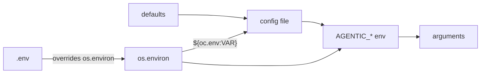
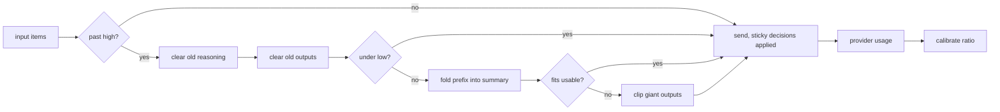
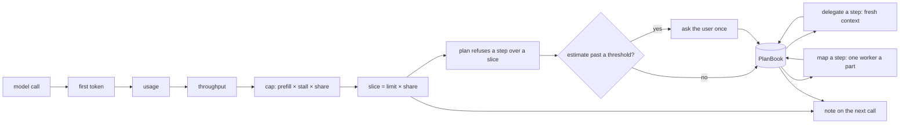
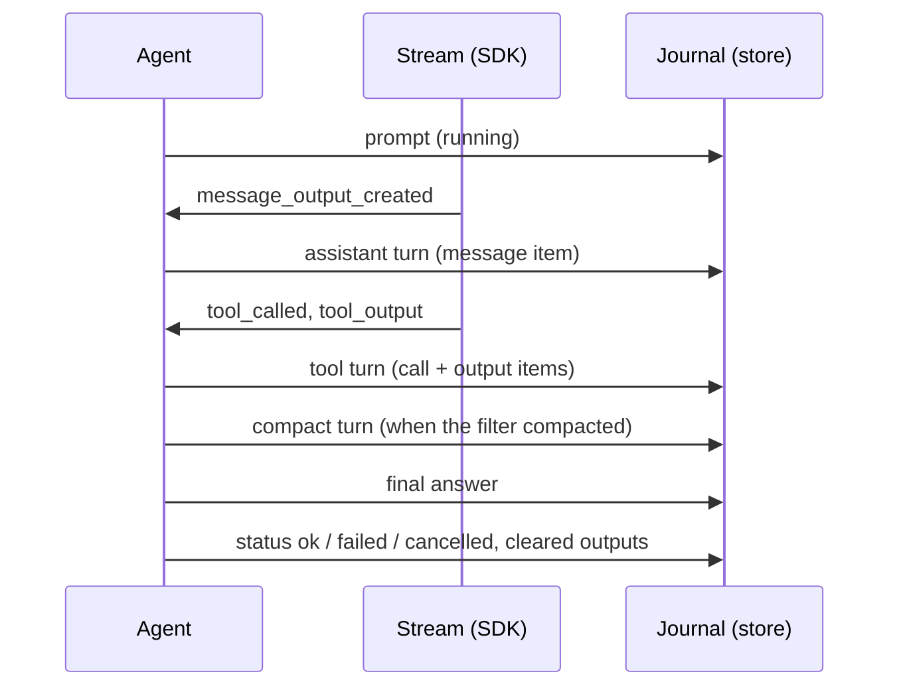
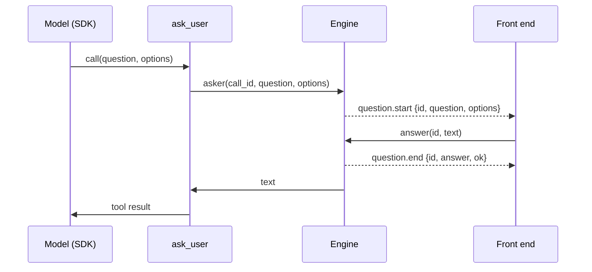

# ⏬ Agentic — Design

A walkthrough of the implementation. It follows the module from the outside in:
the shape of a run first, then each subsystem in the order `agentic.py` declares
them, then the reference tables (configuration, tools, protocol) and the
extension points.

[`README.md`](README.md) is the summary and the quickstart, [`CHANGES.md`](CHANGES.md)
is what has been built and why, and [`TODO.md`](TODO.md) is what is left.

---

## 1. Layout

| File                  | Contents                                         |
| --------------------- | ------------------------------------------------ |
| `app/agentic.py`      | The library: every subsystem and the CLI         |
| `test/agentic_bdd.py` | Unit tests                                       |
| `test/agentic_e2e.py` | Browser capture of the page, scripted end to end |
| `app/agentic_ui.html` | Chat page markup                                 |
| `app/agentic_ui.css`  | Mobile first, theme driven styles                |
| `app/agentic_ui.js`   | Client: blocks, markdown, editor, commands, hub  |
| `test/assets/`        | The screenshots this guide shows                 |
| `pyproject.toml`      | Package metadata, dependencies, `agentic` script |

`agentic.py` is a single flat module divided by commented section banners, in this
order: **config, events, prompt, storage, sessions, memory, repository,
resilience, models, tools, console, commands, core, repl, web, cli**. Each
section is self-contained and depends only on the ones above it, so the file
reads top to bottom.

Dependencies: `openai` and `openai-agents` (the loop), `jinja2` (templates),
`omegaconf` (config files), `websockets` (transport), `cachetools` (LRU).
Python 3.12 or newer.

## 2. Two entry points

The core is split in two classes so the loop can be used without the harness
around it.

`Engine` is the loop: a config, an event bus, a prompt renderer, a tool registry
and a model pool, and nothing else. `Engine.run(model_input, ...)` takes the
model input verbatim — a prompt string or the chat messages the caller assembled
from its own history — builds the tools (the ones passed in, or the built-in set
for a workspace, or none), builds the SDK agent and streams it, publishing the
same `agent.*`, `block.*` and `tool.*` events and returning the same
`RunResult`. It creates no database, no session, no workspace and no console, so
an application that already has that infrastructure embeds it directly and pays
for nothing it does not use. `env=False` keeps the `AGENTIC_*` environment (and
any `.env` file) out of the resolved config, and `config_file=False` keeps a
stray `agentic.yaml` in the working directory of the host process out of it too.

`Agent` subclasses `Engine` and adds the batteries: storage, sessions and their
workspaces, conversation memory, git checkouts, slash commands, the console
renderer, the repl and the web layer. Both share `resolve_config`, `build_model`,
`build_vision`, `build_tools`, `build_sdk_agent`, `turn`, `stream` and the
`running()` lifecycle, so an override or an injected collaborator behaves the
same in either.

## 3. The shape of a run

`Agent.run(template, **overrides)` is the whole story:

1. **Resolve the config.** `resolve_config()` merges overrides onto the instance
   config and turns `input` (a file path or raw text) into `config.input`.
2. **Acquire a session.** Expired sessions are purged, then an existing session
   is reused or a new workspace is created.
3. **Prepare the session.** If a repository is configured it is cloned into the
   workspace on a session branch (idempotent, and never fatal).
4. **Publish `agent.start`** and the prompt as the first block of the run
   (`publish_prompt()`, under the id the journal keeps). Subscribers react.
5. **Render the prompt.** `build_prompt()` renders the template against the
   config, then `decorate_prompt()` appends the attachment listing;
   `decorate_instructions()` has already appended the learned rules.
6. **Build the model input.** `build_input()` prepends the journal of the
   session — messages and tool calls — so the prompt is the newest message of a
   context window rather than a one shot request.
7. **Journal the prompt** (`journal_prompt()`), marked `running`, before the
   model is called.
8. **Build the tools.** A `Workspace` is scoped to the session directory, held
   to `outside_read` / `outside_write` and, unless both are on, given a sandbox
   for its shell; the registry builds the tool list for it, including the git
   tools when the session has a checkout.
9. **Build the SDK agent** with the leader model, the instructions and the tools.
10. **Stream.** `stream()` consumes the SDK event stream and republishes it as
    `block.*` and `tool.*` events, under a stall guard and, while nothing has
    been produced yet, the retry policy of the run. Each finished assistant
    message and tool call goes to `checkpoint()`, which journals it at once.
11. **Remember.** `remember()` journals a final answer no message carried and
    trims (or summarises) the journal back inside its budget.
12. **Finish.** `agent.end` (or `agent.error`) is published with the tokens and
    the cost of the run, `settle()` records how the run ended on its prompt, and
    a `RunResult` is returned; cancellation is re-raised after being recorded.

Failures inside the loop are captured on the result rather than raised, so a
caller always gets a `RunResult` and can branch on `result.ok`, on
`result.error_kind` for what went wrong and on `result.transient` for whether
running it again might work.

## 4. Config

`AgentConfig` is a dataclass with five composition methods:

- `merge(**overrides)` — copy with non-`None` overrides applied; unknown keys go
  to `extras`.
- `with_data(mapping)` — copy with a parsed mapping applied, coerced to the
  annotated type (`int`, `float`, `bool`, `Path`, `str`).
- `with_file(path)` — copy with a JSON or YAML file applied; without a path the
  one `find_config_file()` locates.
- `with_env(environ)` — copy with `AGENTIC_<FIELD>` overrides applied, coerced the
  same way.
- `model_spec(role)` — resolve a role to a `ModelSpec`, or `None`.

`__getattr__` falls back to `extras`, so `config.genre` works in a template when
`genre` was passed as an override. `to_dict(redact=True)` masks anything
`is_secret_key()` recognizes, and `banner_items()` is the console summary.

Resolution order is **defaults → config file → environment → explicit
arguments**, applied in `Engine.__init__` and again per run in
`resolve_config()`. A `.env` file is loaded into the environment before the
config file is read (see [Env files](#env-files)).

### Config files

`find_config_file()` looks for `<stem>.json`, `<stem>.yaml` and `<stem>.yml`,
where the stem is the name of the module itself (`agentic`), in the current
directory first and in the directory of `agentic.py` as a fallback — so an
application overrides whatever ships beside the harness. The first file that
exists wins; there is no merging between them.

- `config_directories()` is the search path, `config_candidates()` every path
  that is looked at, in order, and `read_config_file(path)` the reader.
- Files are parsed with `omegaconf`, so `${oc.env:VAR}` and `${other.key}`
  interpolations resolve at read time. Without it JSON still works and YAML
  falls back to `pyyaml`.
- `flatten_config()` flattens a nested group onto field names — `inference: {vlm:
  v}` becomes `inference_vlm` — but only when every key of the group names a real
  field. Anything else stays as it is and becomes an extra, and a nested
  `extras:` mapping is folded in as is.
- A `null` value leaves the default in place, an empty file is harmless and a
  file that is not a mapping is an error.

`Engine(config_file=...)` decides what the layer reads: `True` (the default)
searches, `False` or `None` skips the layer, and a path is taken as given — a
path that does not exist raises, because the caller named that file. The
resolved path stays on the instance as `engine.config_file`, which is what the
repl banner reports. `--config path` is the same switch from the command line.

### Env files

`find_env_file()` looks for `.env` in the same directories as the config file
(`config_directories()`), and `Engine.__init__` loads it into `os.environ`
before the config file is read, so `${oc.env:VAR}` interpolations and the
`AGENTIC_*` layer both see its values.

- [x] Parsed with `python-dotenv` (quoting, `export`, comments, `${VAR}`
  expansion); a key without a value is dropped.
- [x] The file wins over variables already set in the process environment
  (`override=True`), so editing it always takes effect.
- [x] `env_candidates()` is every path looked at, `read_env_file(path)` the
  side-effect-free reader, `load_env_file(path, environ, override=False)` the
  writer, returning what it applied.
- [x] `Engine(env_file=...)` mirrors `config_file`: `True` searches, `False` or
  `None` skips, a missing named path raises. `env=False` skips it too.
- [x] The resolved path stays on the instance as `engine.env_file`, and the
  repl banner reports it as `Env`.



```yaml
# agentic.yaml
name: scribe
inference:
  url: ${oc.env:AGENTIC_INFERENCE_URL}
  key: ${oc.env:AGENTIC_INFERENCE_KEY}   # omit it entirely for keyless endpoints
  llm: some/leader-model
  vlm: some/vision-model
vision:
  max_tokens: 2048
memory:
  summary: true
template: ./prompt.md
genre: noir
```

### Configuration reference

| Variable / field                                                              | Meaning                                     |
| ----------------------------------------------------------------------------- | ------------------------------------------- |
| `AGENTIC_NAME`, `AGENTIC_INSTRUCTIONS`                                        | Agent name and system instructions          |
| `AGENTIC_INFERENCE_LLM`, `_URL`, `_KEY`                                       | Leader model, endpoint and credential       |
| `AGENTIC_INFERENCE_CTX`                                                       | `num_ctx` sent per request (`0`: look up)   |
| `AGENTIC_MAX_TURNS`                                                           | Maximum agentic turns per run               |
| `AGENTIC_REQUEST_TIMEOUT`                                                     | Timeout per specialist call and connect     |
| `AGENTIC_STREAM_TIMEOUT`                                                      | Leader stall guard; transport read timeout  |
| `AGENTIC_STREAM_HEARTBEAT`                                                    | Seconds between `model.wait` (`0` off)      |
| `AGENTIC_RETRY_ATTEMPTS`                                                      | Attempts per model call (`1` never retries) |
| `AGENTIC_RETRY_BACKOFF`, `AGENTIC_RETRY_MAX_BACKOFF`                          | First wait between attempts, and its cap    |
| `AGENTIC_RETRY_JITTER`                                                        | Fraction of a wait that is randomized       |
| `AGENTIC_COST_INPUT`, `AGENTIC_COST_OUTPUT`                                   | Price of a million input / output tokens    |
| `AGENTIC_INFERENCE_VLM`                                                       | Vision specialist (unset: the leader sees)  |
| `AGENTIC_VISION_API_URL`, `AGENTIC_VISION_API_KEY`                            | Vision endpoint (defaults to the leader's)  |
| `AGENTIC_VISION_INSTRUCTIONS`, `AGENTIC_VISION_MAX_TOKENS`                    | Vision system prompt and answer budget      |
| `AGENTIC_MEMORY_ENABLED`                                                      | Remember the conversation of a session      |
| `AGENTIC_MEMORY_TOOLS`                                                        | Replay journaled tool calls to the model    |
| `AGENTIC_CONTEXT_WINDOW`, `AGENTIC_CONTEXT_RESERVE`                           | Window (`0` asks) and room for the reply    |
| `AGENTIC_CONTEXT_TRIGGER`, `AGENTIC_CONTEXT_TARGET`                           | Compact past / down to (share of budget)    |
| `AGENTIC_CONTEXT_KEEP`, `AGENTIC_CONTEXT_SUMMARY`                             | Outputs never cleared; summarise or drop    |
| `AGENTIC_CONTEXT_TOKENIZER`                                                   | tiktoken encoding (empty: byte estimate)    |
| `AGENTIC_PLAN_ENABLED`, `AGENTIC_SLICE_SHARE`, `AGENTIC_SLICE_STALL`          | Plan tool + note; slice; read-time cap      |
| `AGENTIC_PLAN_ASK_SLICES`, `AGENTIC_PLAN_ASK_MINUTES`, `AGENTIC_PLAN_ASK_COST` | Sizing question thresholds (`0` off)        |
| `AGENTIC_DELEGATE_ENABLED`                                                    | `delegate` tool (workers)                   |
| `AGENTIC_WORKER_MODEL`, `AGENTIC_WORKER_API_URL`, `AGENTIC_WORKER_API_KEY`    | Worker role (defaults to the leader)        |
| `AGENTIC_WORKER_INSTRUCTIONS`, `AGENTIC_WORKER_MAX_TURNS`                     | Worker system prompt and turn limit         |
| `AGENTIC_WORKER_MAX_TOKENS`                                                   | Worker answer cap (`0` uncapped)            |
| `AGENTIC_MAP_PARALLEL`                                                        | `map` workers at once                       |
| `AGENTIC_RULES_ENABLED`, `AGENTIC_RULES_MAX_CHARS`                            | Learned rules; size that raises a warning   |
| `AGENTIC_RULES_INSTRUCTIONS`, `AGENTIC_RULES_MAX_TOKENS`                      | Rule distiller prompt and answer budget     |
| `AGENTIC_SUMMARY_MODEL`, `AGENTIC_SUMMARY_API_URL`, `AGENTIC_SUMMARY_API_KEY` | Summary role (defaults to the leader)       |
| `AGENTIC_SUMMARY_INSTRUCTIONS`, `AGENTIC_SUMMARY_MAX_TOKENS`                  | Summary system prompt and its size          |
| `AGENTIC_INPUT_SOURCE`                                                        | Input path or text (also `--input`)         |
| `AGENTIC_TEMPLATE`                                                            | Template path or raw template for `main()`  |
| `AGENTIC_STATE_DIR`                                                           | Home of the database and the workspaces     |
| `AGENTIC_WORKSPACE_ROOT`, `AGENTIC_WORKSPACE_SEED`                            | Parent of workspaces; directory copied in   |
| `AGENTIC_SESSION_TTL`, `AGENTIC_KEEP_WORKSPACE`                               | Session lifetime; keep the directory        |
| `AGENTIC_SESSION_DURABLE`, `AGENTIC_SESSION_SWEEP_INTERVAL`                   | Survive a restart; expiry sweep period      |
| `AGENTIC_REPO_URL`, `AGENTIC_REPO_BRANCH`, `AGENTIC_REPO_TOKEN`               | Default repository, base branch, credential |
| `AGENTIC_REPO_REMOTE`, `AGENTIC_REPO_BRANCH_PREFIX`, `AGENTIC_REPO_DIR`       | Remote name, branch prefix, clone dir       |
| `AGENTIC_REPO_AUTHOR_NAME`, `AGENTIC_REPO_AUTHOR_EMAIL`                       | Identity the harness commits with           |
| `AGENTIC_REPO_DEPTH`, `AGENTIC_REPO_CLONE`, `AGENTIC_REPO_TIMEOUT`            | Clone depth, auto clone, git timeout        |
| `AGENTIC_DB_PATH`, `AGENTIC_CACHE_SIZE`                                       | SQLite file and LRU capacity                |
| `AGENTIC_SHELL_TIMEOUT`, `AGENTIC_SHELL_ENABLED`                              | Shell tool limits                           |
| `AGENTIC_SHELL_HEARTBEAT`                                                     | Seconds between shell heartbeats (`0` off)  |
| `AGENTIC_READ_OUTPUT_LIMIT`                                                   | Chars per `read_text_file` page (`0` auto)  |
| `AGENTIC_OUTSIDE_READ`, `AGENTIC_OUTSIDE_WRITE`                               | Reads / writes beyond the workspace         |
| `AGENTIC_SHELL_SANDBOX`, `AGENTIC_ASK_ENABLED`                                | Shell confinement backend; `ask_user` tool  |
| `AGENTIC_HOST`, `AGENTIC_PORT`, `AGENTIC_THEME`                               | Web bind address and UI theme file          |
| `AGENTIC_QUIET`, `AGENTIC_COLOR`                                              | Console output                              |

Anything not listed is an extra: pass it as a constructor override and read it in
the template as `config.<name>`.

### Modes

**A mode settles only what the layers left unset (`None`):**

- `MODE_TOOLS` — `outside_read`, `outside_write`, `ask_enabled`: repl all `true`, web `false` / `false` / `true`
- `MODE_STATE` — `state_dir` (`.agentic`), `session_durable` (`true`), `session_ttl` (`86400`): repl and web alike
- `Agent(mode="repl" | "web")` applies both before the store opens; `cli()` passes `mode_of(args)`
- `Repl` and `WebServer` apply `MODE_TOOLS` again, for an agent built without a mode
- a one shot `--input` run and an embedded `Engine` take no mode: confined tools, nothing on disk
- `AgentConfig.state_paths()` derives `db_path` (`<state_dir>/agentic.db`) and `workspace_root` (`<state_dir>/workspaces`) where unset

## 5. Events

`EventBus.publish(type, session_id=..., **data)` builds an `Event` and delivers
it to the subscribers of that type plus the subscribers of `EventType.ALL`.
Handlers may be sync or async; exceptions are printed to stderr and swallowed.
`on()` returns an unsubscriber.

| Event                          | Payload                                    |
| ------------------------------ | ------------------------------------------ |
| `agent.start`                  | `config` (never forwarded to the web)      |
| `agent.end`                    | `output`, `error`, `error_kind`, `usage`, `config` |
| `agent.error`                  | `error`, `error_kind`                      |
| `block.start`                  | `id`, `kind`, `role`; a prompt adds `text`, `attachments`, `complete` |
| `block.delta`                  | `id`, `kind`, `text` (the delta)           |
| `block.end`                    | `id`, `kind`, `text` (the full block)      |
| `tool.start`                   | `id`, `kind`, `name`, `call_id`, `arguments`, `text` |
| `tool.progress`                | `id`, `kind`, `name`, `call_id`, `text` (output, empty for a heartbeat), `duration` |
| `tool.end`                     | the above plus `ok`, `result`, `duration`  |
| `block.*`, `tool.*`, `context.compact` of a worker | as above plus `parent` (the block of the call that started it) and `depth` |
| `model.retry`                  | `role`, `error_kind`, `attempt`, `attempts`, `delay`, `error` |
| `model.wait`                   | `role`, `elapsed` (seconds silent), `timeout` (the stall budget, `0` unbounded) |
| `context.usage`                | `tokens`, `window`, `usable`, `high`, `low`, `fill` (tokens / usable), `estimated` (false when the provider counted), `slice`, `prefill` / `decode` once measured |
| `context.compact`              | `id` (its marker block), `reason`, `tokens_before`, `tokens_after`, `thoughts`, `cleared`, `clipped`, `summarized`, `message` |
| `plan.update`                  | `plan`: steps, `done`, `total`, `current`, `left`, `slices`, `seconds` (`null` when cleared) |
| `question.start`               | `id`, `kind`, `call_id`, `question`, `options` |
| `question.end`                 | `id`, `kind`, `call_id`, `answer`, `ok` (false when cancelled) |
| `feedback`                     | `ok`, `id` (the answer), `vote`, `message`, plus `action`, `rule`, `warning` when learned |
| `session.open`, `session.close`| `kind`, `repo`                             |
| `log`                          | `kind`, `message`                          |

## 6. Prompt

`PromptRenderer` wraps a Jinja `SandboxedEnvironment` with `StrictUndefined` and
`autoescape=False` (the output is a prompt, not HTML). `render(template, config,
**context)` exposes the config as `config` and any context keys by name;
`render_file(path, ...)` reads a template from disk. Output is stripped.

`Agent.decorate_prompt()` appends an `## Attached files` listing when the run
carries attachments, unless the template already contains that heading.

## 7. Storage and cache

`Store` is a namespaced key/value protocol (`get`, `set`, `delete`, `list`,
`close`) with two implementations: `MemoryStore` for tests and `SqliteStore`,
which keeps JSON values in a `store(namespace, key, value, updated_at)` table
and falls back to an in-memory database when no path is given.

A store may also offer `clear(namespace)` (both do, `SqliteStore` in one
statement); `ConversationMemory.forget` uses it when present and deletes key by
key otherwise.

`Cache` is `get`/`set`/`delete`/`clear`, implemented by `LruCache` over
`cachetools` with an optional TTL. Sessions are written to both. `PlanBook`
is a `Cache` written through to a store (namespace `plans`), which is how an
`Agent` keeps its plans across a restart (see [Slicing](#slicing)).

## 8. Sessions

`Session` is `id`, `workspace`, `created_at`, `expires_at` and free-form `meta`
(the git checkout lives under `meta["repo"]`). `SessionManager`:

- `create(**meta)` — a 12 hex character id, a `mkdtemp` workspace under
  `workspace_root`, optionally seeded from `workspace_seed`, persisted to the
  store and the cache.
- `get(id)` — returns the session, closing it first if it has expired and
  renewing its lease otherwise, so an active session is never expired under a
  client and an idle one still runs out.
- `ensure(id)` — get or create.
- `update(session)` — re-persist after mutating `meta`.
- `list()`, `close(id)`, `purge_expired()`, `close_all(destroy=None)`.

`_destroy()` removes the directory (unless `keep_workspace`), the store record
and the cache entry. `_persist()` and `_destroy()` are the hooks to override for
a different lifecycle.

### Durability

The store record of a live session is what makes a session outlive its process:

- `restore()` — called on construction, it rehydrates the sessions the store
  still holds. A record that cannot be read, whose lease has run out or whose
  directory is gone is reconciled away (`_destroy()`) instead of adopted, so a
  restart never hands out a session without a workspace.
- `orphans()` / `reap_orphans()` — directories under `workspace_root` named
  `<prefix>-*` that no live session owns. Only a configured root is scanned and
  only directories this manager could have created, so a shared temporary
  directory is never touched; `keep_workspace` reaps nothing.
- `sweep()` — `purge_expired()` plus `reap_orphans()`.
- `start_sweeper()` / `stop_sweeper()` — run `sweep()` every
  `session_sweep_interval` seconds (`0` disables the timer) on the running loop.
  `WebServer.serve()` starts it and stops it with the server, and
  `Agent.aclose()` stops it too. A failing sweep is reported, not fatal.

`session_durable` decides what a shutdown means: by default `close_all()`
destroys every workspace, and with it set the manager only forgets them so the
next start rehydrates the same sessions (workspaces, `meta["repo"]` checkouts
and transcripts included). Pass `close_all(destroy=True)` to wipe them anyway.
The repl and the web server are durable by default (see [Modes](#modes)).

- [x] `listeners` — called with every session as it is destroyed (closed, expired, reconciled); `Agent` forgets its journal and cancels a run still in it (through the run's own loop, since the sweeper sweeps on a thread).
- [x] `latest(**meta)` — the most recently used live session whose meta matches; the repl resumes `latest(client="repl")`.
- [x] Front ends tag what they open: `meta["client"]` is `repl` or `web`, and `/new` keeps the tag.
- [x] A run renews its lease at every checkpoint; `Agent.reconcile()` forgets, at start, journals whose session did not come back.

## 9. Memory

**The journal keeps every turn; the model sees a window: newest summary → turns after its boundary.**

- `Turn` — one message: `role`, `text`, `created_at`, `seq` (order and store key), plus the block `kind` its role maps onto (`compact` → `compact`)
- `Transcript` — the ordered turns of one session: `append` (numbers them), `summary()`, `boundary()`, `window()`, `messages()`
- `ConversationMemory` — owns them, persisted one record per turn (namespace `transcripts:<session>`, key the zero padded `seq`) under a header record (`transcripts`, `format: 2`)
  - `transcript(session_id)` — load once, then keep in memory; a header holding its turns inline (format 1) is rewritten one record per turn on load
  - `window(session_id)` / `history(session_id)` — the context window, with the turn behind each item / as model input
  - `replay(session_id)` — every turn as JSON for a client that (re)connects
  - `journal(session_id, *turns)` — append and write only the new records; `remember()` is the same for a coroutine caller
  - `persist(transcript, *turns)` — rewrite the records of the turns named (a vote, a status, a cleared output); all of them when none are
  - `forget(session_id)` — erase it, in memory and in the store
- Nothing is trimmed: a write costs one record however long the chat has grown, and what the model sees is [Context](#context)'s business

On the `Agent` side, `build_input()` returns the prompt alone when nothing is
remembered (a one shot run) and `[*window, {"role": "user", …}]` otherwise. The
prompt is kept as the input the user wrote (not the rendered template, which
would be replayed verbatim every turn), and every step of the run is journaled
as it finishes (see [Journal](#journal)), a failed or stopped run included;
`remember()` closes a run that finished with its final answer.
Override it to remember more, less or something else; inject
`memory=ConversationMemory(...)` or subclass it for another policy;
`memory_enabled=False` turns the whole subsystem off. `/forget` clears a
transcript, and `/new` and `/end` forget the session they close.

### Context

**Before every model call: estimate → past `high`? → clear reasoning → clear outputs → summarise → clip → down to `low`.**

> ❗ SDK native compaction (`OpenAIResponsesCompactionSession`, `ModelSettings.context_management`) needs the OpenAI Responses API and `gpt-*` / `o*` models; the harness drives Chat Completions against any provider, so compaction is its own, plugged in through the SDK's `RunConfig.call_model_input_filter`.

Budget (`ContextBudget`):

- `window` — `context_window`, else the provider's listing (`ModelPool.window`), else `DEFAULT_CONTEXT_WINDOW` (128k); a context length error lowers it
- `reserve` — `context_reserve`, else a fifth of the window within 4k–32k: the reply, reasoning included
- `usable` = window − reserve; `high` = usable × `context_trigger` (0.85); `low` = usable × `context_target` (0.5)
- hysteresis: a compaction goes down to `low`, so the next is `high − low` tokens of growth away and the cached prefix holds until then

Counting (`TokenCounter`, one per leader model):

- tiktoken `context_tokenizer` (`o200k_base`), else UTF-8 bytes / 4 (offline, or no vocabulary download allowed)
- per item: framing + text of the content, call name and arguments, output, reasoning; an image a flat 1,024; cached by item digest
- `ratio` — provider tokens per estimated token, an average of what `response.completed` reported against what was estimated for that call; every watermark is compared in those units
- reasoning counts only where the SDK sends it back (`reasoning_replayed`: DeepSeek, which needs it during a tool loop)

Tiers (`Compactor.compact`), cheapest first, each only as far as `low` needs:

1. reasoning before the newest response → `THOUGHT_STUB` (no model call)
2. tool outputs, oldest first, newest `context_keep` (4) spared, under 200 tokens left alone → a stub naming the tool and the tokens it held; over a quarter of `usable` the stub says it is too large to read again whole (ask for a part), else to call the tool again
3. oldest prefix → summary: the smallest safe cut whose tail fits, folded by the `summary` role into the previous summary (anchored, never rebuilt), a chunk per call when the segment outgrows the summary model; skipped when the segment is too small to be worth a call; the newest response is always kept
4. what still exceeds `usable` (a giant newest output) → clipped, head and tail, headed by `CLIP_NOTE` (a repeat returns the same size; ask for a narrower part)

> Loop guard: a clipped read answered by the same read clips again; `read_text_file` pages (`read_output_limit`) so a fresh read always fits, and refuses a cut read repeated back to back (see Tools)

Cuts (`safe_cuts`):

- a call stays with its output, reasoning with what it led to, the calls of a response with the message that announced them
- parallel calls are one unit

Decisions are sticky (`ContextState`): `summary`, `cut` (+ the digest that finds it again), `cleared`, `clipped`, `thoughts`, `pinned`

- every call applies them first, so the input only changes at a compaction
- `pinned` — once the cut passes the request in flight, the summary keeps it verbatim under `PINNED_HEADER`
- the summary reaches the model as a user message opening with `SUMMARY_HEADER` (some chat templates refuse a late system message)
- a failing summarizer leaves an extract of the segment's requests and calls; `context_summary` off drops the segment with a note

In a run (`ContextRun`, the filter):

- `Engine.build_context()` builds it, `turn()` attaches it to `RunResult.context`, `build_run_config()` hands it to `Runner.run_streamed`
- each call: `fit(items)` → compaction if due → `context.usage` (estimated)
- `response.completed` → `observe(input_tokens)` → calibrate → `context.usage` (counted)
- `ContextGuard` wraps the leader's SDK model: a context length error (`is_overflow`) reads the window it names (`overflow_window`, else ¾ of the assumed one), teaches it to the pool, compacts as hard as it goes and retries; twice per run at most, then `ErrorKind.CONTEXT`
- a summary marker block (`kind: compact`) opens before the summarizer is called and closes with the summary

Across runs (`Agent`):

- `prepare_context()` seeds the run's state with the journal's summary and ties each starting item to its turn
- `journal_compaction()` journals each compaction as a `compact` turn; a summary records where it keeps from (`keep_ref`): `{"seq": n}`, or `{"run", "calls"}` for a cut among items the run generated
- `settle_context()` at the end of a run: cleared outputs are marked on their tool turns (`meta["cleared"]`, replayed as the stub, so the next prefix matches what the model last saw) and call references become `seq`
- `schedule_compaction()` after the run: `compact(background=True)` at 0.9 × the trigger, in a task; the next run of the session awaits it (`compacted()`)
- `compact(session, force=True, focus=)` — `/compact [focus]`: everything but the newest response into the summary



### Slicing

**Measure → cap → plan → ask → delegate → recite: a step of work fits the context and the time the model takes to read it.**

> Why: a 27B model on a local GPU reads ~100 tokens/s; after a compaction or a cache miss a 60k context takes 10 minutes to the first token, past the 600s stall guard, and every retry starts over

Speed (`Throughput`, one per leader model, `Engine.speeds`):

- each call is stamped: input handed over (`ContextRun.__call__`), first chunk (`response.created` → `first_token()`), `response.completed` → `observe(input, output, cached)` → `time_call()`
- tokens read: input less the `cached_tokens` the provider reports; else the whole input after a compaction (`rebuilt`), else the growth since the call before less its trailing note; a run's first call without a cache count is not timed
- `prefill` = read / time to first token, `decode` = written / time after it; each the median of the newest `WINDOW` (9) samples, so a dropped cache or a queued request cannot move it; under 512 read or 64 written is noise
- `replies` — output tokens of the newest `WINDOW` calls, timed or not (`wrote()`); `reply` the longest: a reply sent whole keeps the stream silent while it is written
- skipped: a call after `IDLE` (240 s) of quiet on the model (a local server may have unloaded it), and a reply that arrived whole (≥ 8 tokens within `BURST` 50 ms, or faster than `WRITE_LIMIT` 5,000 tokens/s: a tool call some servers hold back)

Cap (`ContextRun.timed()`, `retime()`):

- `timed` = `readable(stream_timeout × slice_stall, reserve)`, at least `TIMED_FLOOR` (8,192): tokens read at `prefill` in that time less the time to write `reply` (at most the reserve) at `decode`, writing never more than `1 − READ_SHARE` (half) of it; nothing reserved while `decode` is unmeasured
- every call records its reply and retimes, so a long tool call sent whole (not timed itself) still shrinks the cap for the next
- `compactor.budget` = `base.capped(timed)`: input capped, reserve kept; `base` is the window's own budget, which an overflow lowers
- a move under `RETIME_STEP` (10%) is ignored; a model timed in an earlier run is capped from the first call, and the background compaction between runs uses the same cap
- the `read_text_file` page follows it: `Engine.page_limit()` asks the run's budget at every read (a quarter of `usable`), so a capped budget never has to clip a fresh page

Slice (`SliceBudget`, `ContextRun.limits()`):

- `limit` = min(`usable`, `timed`); `slice` = `limit` × `slice_share` (0.25); `used` = the context now

Note (`note_text()`, `with_note()`), when `plan_enabled`:

- added after compaction to what is sent, never journaled: folded into a closing user message, else a user message of its own (never two in a row)
- `NOTE_HEADER`, then `[budget] context U of L tokens; one step may read up to S; the model reads ~R and writes ~W tokens/s`, then `[plan] d/n done; now k. title`
- cache cost: the provider re-reads the newest response and the note, nothing older

Plan (`Planner`, the `plan` tool, `Engine.plans` by session):

- `plan(steps=[{title, inputs, status}])` replaces the whole plan; `status` is `pending`, `active` or `done`; the schema is inlined (no `$ref`)
- an input is a path, a directory, a glob or a line range `path:A-B`, resolved as a read (`outside_read` applies); ≤ 500 files; an image 1,024
- a glob is walked lazily from the root (`root_dir`, never a pattern itself); confined, it may not be absolute or use `..`, and a match or directory entry resolving outside is skipped silently (nothing outside is revealed)
- counted exactly up to 256 KiB a file or range and 4 MiB a plan, the rest estimated from its size; a range is read 64 KiB at a time (one line may be huge)
- a step not done that reads more than a slice is refused, with its inputs and sizes; the same steps sent back are kept with a warning (a line cannot be split)
- the answer lists each step with its tokens, what is left to read and, past a minute, how long at the measured speed
- `Engine.plans` is an `LruCache` of 256 sessions, cleared by `close()`; an `Agent` swaps in a `PlanBook` (below)

Sizing question (`Planner.consult()`, `AskLimits`, `Estimate`):

- `plan(steps, question=, options=)`: the model puts one question about the split on the call instead of an `ask_user` of its own
- `Plan.estimate()` — what the steps not done still take: tokens, slices (`ceil(left / slice)`), minutes at the measured `prefill`, cost at `cost_input`
- `AskLimits.of(config)` — `plan_ask_slices` (8), `plan_ask_minutes` (10), `plan_ask_cost` (1.0); `0` turns one off; passed strictly
- asked when a threshold is passed or the model has a question, through the run's `Asker` on the block of the `plan` call: `This plan is large: 3 steps, ~1.5k tokens to read in 2 slices, ~12 min at ~2 tokens/s. Go ahead?`
- options: the model's, else `Go ahead` / `Stop`; the default `Stop` drops the plan, any other answer comes back as `The user answered: …`
- once per plan (`Plan.asked`, carried over by every update until a plan with every step done is replaced); a refused plan asks nothing; no asker (one shot, embedded): the model is told to decide itself

Plans across runs (`PlanBook`, `Agent.plans`):

- a `Cache` over the store: memory first (LRU, 256), every `set` written through (namespace `plans`, key the session), a miss read back
- `Planner.update()` and `Planner.mark()` write the whole plan, so the newest status survives a crash
- `clear()` empties memory only (`close()`); `delete()` forgets both: on `session_closed`, `/forget`, and in `reconcile()` for sessions gone after a restart
- the budget note of the next call, in any run or process, recites it; `Agent.resume()` appends `RESUME_PLAN` and the whole plan to `RESUME_PROMPT` while a step is open

Shown (`plan.update`, `context.usage`, `/plan`):

- `Plan.view(limits, throughput)` — what a client shows: steps (`title`, `status`, `tokens`, `missing`), `done`, `total`, `current` (1-based, 0 none), `left`, `slices`, `seconds`
- `Planner.notify` is awaited with the view after every change (`changed()`): a plan kept, cleared or dropped, a step marked by `delegate`; a refused plan changes nothing; `Engine.build_planner()` publishes it as `plan.update` (`plan`: the view, `null` when cleared)
- `context.usage` adds `slice` and, once measured, `prefill` / `decode` (`ContextRun.usage()`)
- `hello` carries `plan` (`Engine.plan_view()`), so a client that joins shows it at once
- `/plan` — the steps as a checklist, the current one bold, what is left and the speeds (`plan_report()`), with `plan` the view
- console: `[plan] d/n done; now k. title` on every `plan.update` (`plan_line()`), the speeds on the `ctx` line at the end of a run (`speed_line()`)
- page: one arc per step around the mark and a strip in the bar that opens into the steps (see [The mark](#the-mark))

Workers (`delegate`, `Engine.build_delegate()`, `run_worker()`):

- `delegate(task, inputs=[], step=0, tools=[])` runs one step in a fresh context and returns only its answer
- inputs measured like plan inputs (a fresh `Planner`); over `worker_budget()` (`WORKER_SHARE` 0.5 of the worker's window, under its time cap) refused once with sizes, sent back runs anyway
- `step` names a plan step: its inputs are the default; `active` while the worker runs, `done` on an answer, its old status on a failure, kept `active` when cancelled (so `/resume` picks it up)
- `worker_config()` — the `worker` role (`worker_model`, else the leader) as the leader of a config with `worker_instructions` + `Answer within about N words.`, `worker_max_turns`, and `plan_enabled` / `ask_enabled` / `delegate_enabled` off
- `fork(bus)` — a shallow copy of the engine on a private `EventBus`: same pool, counters, speeds and class overrides; the worker's `RunResult` has no session, so `Agent.checkpoint()` journals nothing of it
- `build_run_tools()` builds the worker's own tools (a fresh `ReadRepeats`, its own read page); `tools` keeps only those named (an unknown name is an error listing the rest)
- `WorkerRelay` relays the private bus: the worker's blocks, calls and compactions (`NESTED`) are published on the leader's bus by `nest()` with `parent` (the `delegate` block) and `depth` (1), and the call gets a heartbeat (`tool.progress`, empty) at most once a second; each keeps the leader's stall guard satisfied; the worker's `agent.*`, `context.usage`, waits and retries never reach the leader's bus (without a parent block it falls back to `-> call(...)`, `!! name failed: …`, `~~ compacted …` lines)
- answer: `worker.output`, clipped to `worker_max_tokens` (head and tail), then `[worker: N tool calls in Ss]`; a failure is `Error: the worker failed (kind) after N tool calls: …`, never raised
- tokens: the worker's calls are recorded on the run's `Usage` through `current_usage()`, so `agent.end` prices them
- shown: the page nests the worker's blocks in the `delegate` block (a thread down the left edge, each step folded to its head once done, no votes on its answer); the console indents its calls, outcomes, compactions and answer under the call (`  | `, two spaces a level), leaving out what it streams so parallel workers never interleave within a line; nothing of it is journaled, so a reload shows the `delegate` answer alone

Map (`map`, `Engine.build_map()`, `Planner.chunks()`, `map_parts()`):

- `map(task, inputs, chunk_tokens=0, step=0, tools=[])` runs one task over inputs too large for one worker; built with `delegate` (`delegate_enabled`)
- cut: `Planner.chunks(inputs, limit, most)` — each file (or range `path:A-B`) at line boundaries into parts of at most `limit` tokens (`worker_budget()`, or `chunk_tokens` when smaller): `path:A-B` with its tokens, a file that fits whole named alone, a longer line a part of its own, an image one part; counted while 4 MiB last, then estimated; reading stops once past `most`
- more than `MAP_LIMIT` (64) parts is refused: map fewer inputs at a time
- answers share the leader's slice: each worker is told `Answer within about N words` for `map_answer()` = slice / parts, within `worker_max_tokens`, at least `MAP_ANSWER` (100)
- each part: `map_prompt()` (the task, `Your part (k of n): path, lines A-B (~T tokens)` and the `read_text_file` call that reads it), one worker (`run_worker`, no trailer), `map_parallel` (1) at once (`asyncio.Semaphore`); a `part k/n` tool block nested under the `map` call, its worker's steps at depth 2
- answer: `Mapped n parts (~T tokens) of inputs in Ss[, f failed]:` then `## k/n path:A-B` and each answer in order; a failed part is marked `(failed)` with its error, the others kept
- `step` lends its inputs and is marked like a delegated step (`done` only when no part failed)



### Journal

**A run writes ahead: prompt → each finished step → final answer → status.**

- `Turn` also carries `id` (the block it came from), `run`, `items` (raw model input items) and `meta` (`status` on a prompt, `vote` on an answer, `name` / `ok` on a tool call)
- `Turn.replay(tools)` — its items when it has them, else the plain message; a tool turn without items, or with `tools` off, is left out
- `Transcript.messages(tools)` is the context window; `find(id)`, `run_of(run)`, `prompt_of(run)`, `last_run()` look it up
- `ConversationMemory.journal(session, *turns)` appends and persists the new records at once
- `ConversationMemory.TOOL_LIMIT` (8,000) clips a tool output in the journal, head and tail; `tools` (`memory_tools`) keeps calls out of the replay
- `Agent.journal_prompt()` writes the prompt (`status: running`); `Agent.checkpoint()` journals each step the stream reports; `Agent.settle()` writes `ok`, `failed` (with `error`) or `cancelled`
- `Agent.unfinished(session)` — the prompt of the newest run when it did not finish and nothing live is behind it; `Agent.resume(session)` runs `RESUME_PROMPT` through the passthrough template over that context
- `Agent.live` — the run in flight per session, with its task

Raw items keep the context well formed: an assistant message is a `ResponseOutputMessage` the Chat Completions converter merges its tool calls into, and a tool call is journaled only with its output.



### Rules

**A vote becomes a rule: trace + existing rules → distiller → add or edit → instructions.**

- `Rule` — `id`, `polarity` (`do` / `avoid`), `text`, `votes`, timestamps; `line()` is `Do: …` / `Avoid: …`
- `RuleBook` — the rules in the store (namespace `rules`): `rules()`, `get`, `add`, `edit`, `drop`, `clear`, `render()`, `decorate(instructions)`
- `RuleBook.learn(vote, turns, distill, note=)` — under a lock: `messages()` (rules, trace cut to `TRACE_LIMIT`, verdict, note) → `distill` → `parse()` (JSON, else the reply as the rule; an edit of an unknown id adds) → `add` / `edit`
- `RuleBook.warning()` — set while the rendered rules exceed `max_chars` (`rules_max_chars`)
- `Agent.build_distiller(config)` — the `summary` role (falling back to the leader), `rules_instructions`, `rules_max_tokens`
- `Agent.feedback(session, vote, target=, note=)` — rates one answer (the newest when no target), once: claims it, learns from its run up to it, persists the vote, publishes `feedback`
- `Agent.decorate_instructions()` appends `RuleBook.render()` to the instructions of every run

## 10. Repository

Three types:

- **`RepoSpec`** — a frozen, addressable repository. `from_config()` builds it
  from the `repo_*` fields. `parts` normalizes `owner/name`, `https://…`,
  `git@host:owner/name.git` and filesystem paths into `(host, slug)`;
  `clone_url` is credential-free; `api_url` is `https://api.github.com` or
  `https://<host>/api/v3`; `authenticated_url()` embeds the token for a single
  invocation; `mask()` strips the token from text (tokens under 8 characters are
  left alone); `identity()` returns the `git -c user.*` arguments.
- **`RepoManager`** — runs git and talks to the forge. `git(*args, cwd=…)` uses
  an async subprocess with `GIT_TERMINAL_PROMPT=0`, a timeout and masked output.
  `clone()` clones (optionally shallow, optionally at a base branch), rewrites
  the remote to the clean URL, records the base branch and checks out
  `<prefix>/<session id>`. `status()` is `git status --short --branch`;
  `commit()` stages everything, refuses an empty message or an empty index, and
  commits under the configured identity; `push()` pushes `HEAD:refs/heads/<branch>`
  to the authenticated URL; `open_pull_request()` POSTs to
  `/repos/<slug>/pulls` with a bearer token and returns `number`, `url`, `title`
  and `state`.
- **`Checkout`** — the clone inside one session (`path`, `branch`, `base`,
  `url`), serialized into `session.meta["repo"]`. It forwards `status`, `commit`,
  `push` and `pull_request`, and `publish()` chains commit → push → pull request.

`Agent.prepare_session()` performs the clone on first use, records it on the
session and publishes `session.open`; a `RepoError` is logged and the session
continues without a checkout. `Agent.checkout(session)` rebuilds a `Checkout`
from the stored metadata.

## 11. Resilience

Every call to a provider is bounded and classified, because the two ways a run
dies without the harness noticing are a provider that stops answering and a
provider that answers with a failure nobody can interpret.

`ErrorKind` is the taxonomy: `timeout`, `rate_limit`, `connection`, `server`,
`auth`, `invalid_request`, `max_turns`, `cancelled` and `internal`, with
`ErrorKind.TRANSIENT` naming the four an identical attempt may get past.
`classify_error(exc)` places a failure by the class name of the exception
(`ERROR_KINDS`, so no provider SDK has to be imported), then by the HTTP status
it carries (`status_kind`), then by whether it is an `OSError`; anything left is
`internal`. A failed model call is raised as a `ModelError` carrying `kind`,
`role`, `attempts` and the `detail` the provider gave — except an `internal`
one, which is re-raised untouched so a defect here is never dressed up as a
provider fault.

`RetryPolicy` is how a call is made: `attempts` in total, `timeout` per attempt,
`stall` as the longest silence between two events of a stream, and a wait of `backoff * 2 ** (n - 1)` after failure *n*, capped at
`max_backoff` and multiplied by a random factor in `[1 - jitter, 1]` so clients
a provider failed together do not return together. `RetryPolicy.from_config()`
reads `request_timeout`, `stream_timeout` and the `retry_*` fields; `Engine.build_policy()` is the
hook that returns it. `policy.call(operation, role=…, bounded=…, resumable=…,
on_retry=…)` awaits the operation under all of it: cancellation is never
retried, `resumable` lets the caller veto a retry, and `on_retry` publishes
`model.retry`.

Retrying belongs to the policy alone: `ModelPool.client()` builds its
`AsyncOpenAI` with `max_retries=0`, because a retry inside the SDK is invisible
to the event bus, unjittered, uncounted and nested inside whatever the harness
is already doing. The transport timeout it keeps (from the policy of the pool,
which `Engine` builds from the config) is what stops a socket that went quiet
mid-response: an `httpx.Timeout` whose connect, write and pool bounds are
`timeout` and whose read bound is the longer of `timeout` and `stall`, since the
leader's stream shares the client of its endpoint and may be silent for longer
than a request may take.

The leader and the specialists are bounded differently, because they are shaped
differently. A specialist completion is one request, so `ModelPool.complete()`
wraps the whole call in the timeout. The leader's stream is a long lived read
whose duration is legitimately unbounded, so it is bound by `stall`
(`stream_timeout`, default 600s) as a **stall guard** instead:
`Engine.next_event()` bounds the wait for the *next* event, and
`Engine.stall_timeout()` extends that budget by `shell_timeout` while a tool
call is outstanding, since the SDK runs tools inside the same stream and a slow
shell command must not look like a stalled provider. The budget runs from the
latest sign of life rather than from the start of the wait: every
`tool.progress` report of an open call stamps `ToolCall.seen_at`
(`Engine.alive_at()`), and `next_event(events, timeout, alive)` keeps waiting
while that stamp is fresh, so a command that is still heartbeating is never
mistaken for a dead provider and only a silent tool is bound by the budget. The
guard is not `request_timeout` because a silent stream is not always a dead one:
Ollama sends a tool call whole once the model has finished writing it, so a
`write_file` of a long document is minutes without a byte (a 3.4K char call on a
9B model was 17s of silence, a 1,000 line story is several minutes). That
silence is published rather than hidden: while no tool call is open,
`next_event(..., heartbeat=, on_wait=)` hands the seconds waited so far to
`on_wait` every `stream_heartbeat` seconds (5s, `0` off), and
`Engine.wait_reporter(result, budget)` publishes it as `model.wait` with the
budget it runs against. The heartbeat observes the wait and never extends it,
a failing observer is logged and ignored (`Engine.notify_wait`), and silence
while a tool runs is left to the tool's own `tool.progress`. A stream
that fails is retried only while `result.blocks` and `result.tools` are still empty: after
that a second attempt would replay work the consumer has already seen, so the
failure is reported instead. An abandoned stream is cancelled
(`Engine.cancel_stream`) rather than left running.

`Usage` is the accounting: `requests`, `retries`, `input_tokens`,
`output_tokens`, `total_tokens` and `cost`. `record(raw)` accepts either naming
(`input_tokens`/`prompt_tokens`) from an object or a dict, `price(in, out)`
costs the tokens at rates quoted per million (`cost_input`, `cost_output`) and
`to_dict()` is what `agent.end` carries. Each run owns one on
`RunResult.usage`, and `Engine.running()` publishes it in the `_USAGE` context
variable for the length of the run, so a model call made anywhere underneath —
a tool delegating to the vision model, the summariser of the memory — is counted
without being handed a sink (`current_usage()`, `record_usage()`). Concurrent
runs never share it, because each run is its own task. `ModelPool.usage` keeps
the totals of everything the pool has ever spent, `usage_of(streamed)` extracts
what an SDK run reports, and a failed attempt is accounted too: the tokens were
spent whether or not the answer arrived.

## 12. Models

`ModelSpec` is `(role, name, api_url, api_key)` with `endpoint` as its identity.
`ModelPool` caches one `AsyncOpenAI` client per endpoint and one
`OpenAIChatCompletionsModel` per `(name, url, key)`, and offers two calls beyond
the loop: `complete(spec, messages, max_tokens=…)` for a single completion and
`describe_image(spec, data_url, question, …)`, which sends the system
instructions plus a text/image message pair and returns the text answer. Both
take a `policy=`, a `usage=` sink and an `on_retry=` callback, and both fall
back to the policy of the pool; what they spend lands on `ModelPool.usage`, on
the sink and on the run in progress.

The key is optional: an empty `api_key` leaves the SDK's own environment lookup
in place, and when that would find nothing the pool passes a placeholder so
keyless endpoints (a local Ollama, a proxy) construct a client at all.

`ModelPool.window(spec)` asks the endpoint for the model's context window once
(`PROBE_TIMEOUT`, never failing a run): its `/models` listing under any of
`WINDOW_KEYS` (OpenRouter, Together `context_length`, vLLM `max_model_len`,
Groq `context_window`, LM Studio and Mistral `max_context_length`, LiteLLM
`max_input_tokens`), then an Ollama server's own API (`/api/ps` for a loaded
model, `num_ctx` from `/api/show`, else `OLLAMA_CONTEXT_WINDOW`, since Ollama
truncates a longer prompt silently). `learn_window(spec, n)` keeps one an
error revealed. The SDK agent asks for usage on every stream
(`ModelSettings(include_usage=True)`): it prices the run and calibrates the
context count.

`ModelPool.num_ctx(spec)` is the context size sent with every request as
`extra_body={"options": {"num_ctx": n}}` (leader via `ModelSettings.extra_body`,
specialists via `complete`): `spec.num_ctx` (`inference_ctx`) when set, else the
trained length from Ollama `/api/show` (`model_info.<arch>.context_length`,
`probe_ctx`, once per model), else nothing is sent. Ollama 0.34's `/v1` drops
`options`, so it only takes effect on a server that reads it; `window` is not
derived from it.

`Agent.build_model(config, role)` pulls from the pool, disables SDK tracing and
sets the leader's client as the SDK default. `Agent.build_vision(config)` returns
a `(data_url, question) -> text` delegate, or `None` when no vision model is
configured — which is exactly what decides the image tool.

## 13. Tools

`Workspace` is the sandbox. `resolve()` rejects empty paths, strips quotes,
anchors relative paths at the root and refuses anything that resolves outside it
(which also blocks symlink escapes). `resolve(raw, read=True)` skips that check
when the workspace was built with `outside_read`, and a write (`read=False`)
when it was built with `outside_write` (both from the config fields of the same
names), so the tools may leave the root only as far as the flags say; they tell
the model so in their descriptions. The fields are tri-state: `None` is settled
by the mode through `AgentConfig.with_defaults()` — the repl allows both, the web
server neither, and anything else builds the workspace with `bool(None)`, i.e.
confined. An explicit value always wins. On top of it: `read_text` (2 MiB cap),
`write_text` (creates parents), `list_dir`, `read_data_url` (base64 with a
guessed MIME type, empty files rejected), `apply_patch` (unified diff via
`agents.apply_diff`, with `create_file` / `update_file` / `delete_file`) and
`run_shell` (async subprocess, cwd at the root, stdin closed, stdout + stderr +
exit code returned as text, clipped by `clip_output()` to `shell_output_limit`
characters with head and tail kept).

`run_shell(command, progress)` reads both pipes as the command writes them and
hands every decoded chunk to the optional `progress` callback, plus an empty
string every `shell_heartbeat` seconds while the command is still running; a
callback that raises is logged and never breaks the command. On timeout or
cancellation the whole process tree is killed by `kill_tree()` (`taskkill /F /T`
on Windows; elsewhere `os.killpg` on the process group `start_new_session` gave
the shell), not just the shell: a grandchild holding the pipes would otherwise
outlive the
shell and keep the call waiting until it ended on its own. The wait for the
pipes after a kill is bounded by `Workspace.KILL_GRACE` (5 s), after which they
are abandoned with a diagnostic on stderr.

### Sandbox

**The shell is held to the outside flags: unconfined only when both are on, else sandboxed, else withheld.**

- `Workspace.confined` — some outside path is off limits; `shell_allowed` — not confined, or a `sandbox` is set
- `run_shell` on a confined workspace with a sandbox execs `sandbox.argv(command, ws)` with `sandbox.environ(env, ws)`; the primitive itself never refuses, `ToolRegistry` decides
- `Sandbox.paths(ws)` — `(read, write, full)`: `system_paths()` or `/`, `/` only with `outside_write`, the workspace
- `Sandbox.environ()` — `TMPDIR` into `.sandbox/tmp`; `HOME` into `.sandbox/home` when reads are confined, else `XDG_CACHE_HOME` into `.sandbox/cache` when writes are
- `LandlockSandbox` — `python -I -S -c LANDLOCK_LAUNCHER <policy>`: a ruleset for the ABI the kernel has (refer, truncate, ioctl when present), then `/bin/sh -c`; exits 126 on any failure
- `BubblewrapSandbox` — `bwrap` read-only binds of the read paths, binds of the write paths, `--dev /dev`; probed once
- `SeatbeltSandbox` — `sandbox-exec -p` with `(allow default)` and `deny file-write*` / `deny file-read-data` outside the allowed paths
- `pick_sandbox(name)` — `auto` tries `SANDBOXES` in order; `none`, an unknown name or no backend gives `None`
- `Engine.build_sandbox(config)` — the hook (`shell_sandbox`); a withheld shell is reported once on stderr

> ❗ Network access is not restricted by any backend; Seatbelt is not exercised by the tests on Linux.

`ToolRegistry.build(workspace, vision=…, checkout=…, progress=…, ask=…)`
assembles the list. `progress` is a `ToolReporter`, `(call_id, text) -> None`:
the shell tool takes the SDK `ToolContext` to learn the id of its call and
reports under it; `Engine.tool_reporter(result)` is the reporter of a run, which
stamps the call alive and publishes `tool.progress` on its block. `ask` is an
`Asker`, `(call_id, question, options) -> answer`: when it is given the leader
gets `ask_user`, which takes its call id the same way, drops blank options and
returns `(the user did not answer)` for an empty answer. `planner` adds `plan`,
whose sizing question goes through the same `ask` on the block of its call;
`delegate` (a `Delegator`, `(call_id, task, inputs, step, tools) -> answer`)
adds `delegate`. `Engine.build_run_tools(workspace, config, result)` wires all
of them to one run, for the leader and for each worker alike.

| Tool                | Present when                | Effect                                    |
| ------------------- | --------------------------- | ----------------------------------------- |
| `list_directory`    | always                      | List a workspace directory                |
| `read_text_file`    | always                      | Read a UTF-8 file, a page at a time       |
| `write_text_file`   | always                      | Write a file, creating parents            |
| `apply_patch`       | always                      | Apply a unified diff                      |
| `view_image`        | no vision model             | Return the image as a data URL            |
| `describe_image`    | vision model configured     | Ask the specialist about the image        |
| `run_shell_command` | `shell_enabled`, unconfined or sandboxed | Run a command in the workspace |
| `ask_user`          | `ask_enabled` (repl, web)   | Ask the user, wait for the answer         |
| `plan`              | `plan_enabled`              | Plan steps, each measured against a slice |
| `delegate`          | `delegate_enabled`          | Run one step in a fresh context (a worker) |

Paged reads (`read_text_file(path, offset=1, limit=0)`):

- `Workspace.read_page(path, offset, limit, max_chars)` → `TextPage`: whole lines from `offset` (1-based), at most `limit` lines and `max_chars` characters; a first line longer than the cap is clipped
- `TextPage.render()` — the file as is when whole, else the lines + `[lines A-B of N of path; continue with offset=B+1]`
- `max_chars` is `Engine.page_limit()`: `read_output_limit`, else a quarter of the run's usable budget at each read, time cap included (× 4 chars/token, ≥ 2,000, at most `Engine.read_limit(config)`); `-1` reads whole
- `ReadRepeats` — per tool build: a cut read repeated back to back with the same arguments returns an error naming the next range instead of the same page; `write_text_file`, `apply_patch` and `run_shell_command` forget it
| `git_status`        | the session has a checkout  | Branch and working tree                   |
| `git_commit`        | the session has a checkout  | Stage everything and commit               |
| `git_push`          | the session has a checkout  | Push the session branch                   |
| `open_pull_request` | the session has a checkout  | Open a pull request, return its URL       |
| `publish_work`      | the session has a checkout  | Commit, push and open the pull request    |

Registered factories (`registry.register(name, factory)`) are appended last and
receive the `Workspace`. `ToolRegistry.guard` wraps every tool so `WorkspaceError`,
`RepoError`, `OSError` and `ValueError` become `Error: …` text for the model,
while `functools.wraps` preserves the signature the SDK turns into a schema.
The hosted SDK tools are not used: they need the Responses API, and Chat
Completions backends only support plain function tools.

## 14. Console

`ConsoleRenderer.attach(bus)` subscribes to `EventType.ALL`. It prints a banner,
opens and closes blocks as they stream, styles them per kind (dim italic
reasoning, dim tool, red error), prints every tool call as `-> name(args)` and
its outcome as `<- name: ok in 12 ms` followed by the result, and disables colour
when the stream is not a TTY
or `AGENTIC_COLOR` says so. `write()`, `style()` and `banner()` are the override
points; `banners=False` keeps the config banner from being printed on every run
(which is what `Repl.greet()` and `WebServer.greet()` do after printing their own), and `Agent(console=False)` or
`AGENTIC_QUIET=1` removes the renderer entirely.

Streamed text (`block.delta`) is gathered into frames: `gather()` queues it and
`flush()` prints it once per `frame` seconds (`ConsoleRenderer.FRAME`, 50 ms) via
`loop.call_later`, or sooner when the kind changes or anything else is printed —
every other event and every direct `emit()` flushes first, so order never
changes, only timing. `frame=None` frames a TTY only (tests and pipes write at
once), `frame=0` disables it, and without a running loop text is written at
once.

## 15. Commands

`CommandRegistry` maps a name to a description and a handler.
`parse("/name args")` returns `(name, args)`, and `invoke(text, **context)`
dispatches, awaiting async handlers. Handlers receive `args` plus the context the
caller supplies (`session_id`, `connection`) and return a dict with at least
`ok`; `session`, `sessions`, `commands` and `message` are understood by the
client.

| Command             | Effect                                            |
| ------------------- | ------------------------------------------------- |
| `/help`             | List the available commands                       |
| `/new`              | Start a new session (cloning the repo if set)     |
| `/end [id]`         | End a session and wipe its workspace              |
| `/sessions`         | List live sessions                                |
| `/use <id>`         | Switch to an existing session                     |
| `/forget`           | Forget the conversation of the current session    |
| `/resume`           | Continue the run that did not finish              |
| `/compact [focus]`  | Summarise the conversation now (optional focus)   |
| `/plan`             | The plan as a checklist, what is left, the speeds |
| `/good [why]`       | Rate the last answer good: learn a rule           |
| `/bad [why]`        | Rate the last answer bad: learn a rule            |
| `/rules [drop <id>\|clear]` | List or prune the learned rules           |
| `/model [name]`     | Show or set the leader model                      |
| `/vision [name\|none]` | Show or set the vision specialist              |
| `/repo [url\|none]` | Show, set or clear the default repository         |
| `/clone`            | Clone the repository into the current session     |
| `/status`           | Branch and working tree of the checkout           |
| `/commit <message>` | Stage everything and commit                       |
| `/push`             | Push the session branch                           |
| `/pr <title>`       | Open a pull request (body on the following lines) |
| `/publish <title>`  | Commit, push and open the pull request            |

`/clear` and `/theme` are client-side only and never reach the server, and
`/exit` (with `/quit`) is answered by the repl rather than the registry. A
result with `resume: true` asks its front end to start `Agent.resume()`, since
the front end owns the task and the stream of a run.

## 16. Core

`Block` is a chronological unit of content (`id`, `kind`, `role`, `text`, and
`done` once nothing more will stream into it),
`ToolCall` is one tool invocation (`name`, `call_id`, redacted `arguments`,
`result`, `ok`, `duration`, with `signature()`, `report()` and `to_dict()`) and
`RunResult` collects the blocks, the tool calls, the rendered prompt, the final
output, the error and its `error_kind`, plus the `usage` of every model call the
run made and the `turns` it added to the context window (assistant messages and
tool calls as raw input items, which an embedded caller appends to its own
history), with `ok`, `transient`, `fail(error, kind)` and `text_of(kind)`. Its
`run_id` is unique per run and is part of every block id
(`{session}-{run}-{n}`), so the runs of one session never collide in a client
that keys blocks by id.

`Engine.run()` is the loop on its own, `Agent.run()` is the loop inside a
session; both wrap the body in `running()`, the async context manager that
publishes `agent.start`, records a failure as `result.error` and its classified
`result.error_kind` (re-raising only cancellation), holds the usage of the run in
the `_USAGE` context variable while the body runs and always publishes
`agent.end` with the priced tokens. `turn()` builds the workspace, the tools and
the SDK agent for one pass and hands it to `stream()` under the retry policy of
the run.

`Engine.stream()` consumes `Runner.run_streamed(...).stream_events()`, keeps only
raw response events and maps them with `DELTA_KINDS`:
`response.reasoning_summary_text.delta` and `response.reasoning_text.delta`
become `reasoning`, `response.output_text.delta` becomes `output`. A change of
kind closes the current block and opens the next, so block boundaries follow the
model rather than the transport; `response.function_call_arguments.delta` only
closes the block the model was writing.

Tool calls arrive as run item events instead. `tool_called` opens a `tool` block
and publishes `tool.start` with the tool name, the call id and the arguments
parsed out of the JSON of the model; `tool_output` finds the call by its id
(falling back to the oldest one still open), records the result and publishes
`tool.end` with the outcome, the result and the duration. Both payloads carry a
ready made `text` line, `ToolCall.report()`, for a renderer that does not want to
format the fields itself. Every call is kept on `RunResult.tools`, so a finished
run can be audited without subscribing to anything.

The same run item events feed the journal: `message_output_created` and each
`tool_output` whose call is known hand a `Turn` to `Engine.checkpoint()` — the
item converted by `Engine.input_item()` (`to_input_item()`, JSON safe) — which
keeps it on `RunResult.turns`; `Agent.checkpoint()` also journals it.

In between, a tool that reports progress publishes `tool.progress` on the same
block id: `text` is output it produced (redacted and cut like a result) or empty
for a heartbeat, and `duration` is the time the call has run so far. The console
prints a dim `.` per heartbeat after the `->` line; the web UI tails the output
in the tool block (last 4,000 characters), counts the seconds in its label and
pops the hero mark once per report.

### Questions

The model asks the person behind a run through `ask_user`, and the core only
brokers the question; a front end shows it and answers it:

- [x] `Engine.build_asker(config, result)` is the `Asker` of a run, or `None`
  unless `ask_enabled` — tri-state like `outside_read`, settled by the mode
  (`Repl` and `WebServer` set `True`, an embedded engine or a one shot run stay
  off, since a question nobody can answer would hang the run).
- [x] A question takes the id of its tool call's block, so a client turns that
  block into the card; a question without a known call gets
  `{session}-{run}-q{random}`. It is published as `question.start`, kept in
  `Engine.questions` (`id -> (session, future)`) and ends with `question.end`
  carrying the answer and `ok` — `ok` is false when the run was cancelled under
  it, which is published too.
- [x] `Engine.answer(id, text, session_id=…)` resolves it and returns whether
  there was such a question; with a `session_id` the question must belong to
  that session.
- [x] `Engine.pending_questions(session)` returns the open questions of a
  session as `question.start` published them (`Engine.asking`), which is how a
  client that (re)connects shows the card again.
- [x] While it waits the call is marked `ToolCall.asking`, and `alive_at()`
  reports such a call as alive now: the stall guard bounds silent models, not
  people who are thinking. Stop (web) or Ctrl-C (repl) cancels the run and the
  question with it.



`redact()` is applied to arguments and results before they leave the harness: a
key that looks like a credential (`token`, `password`, `api_key`, … — the
`SECRET_KEYS` list) becomes `[redacted]`, and any value longer than
`Engine.TOOL_VALUE_LIMIT` (512 characters) is cut. Override `redact_arguments`,
`tool_result_of` or `TOOL_VALUE_LIMIT` to change what a deployment publishes.

`Engine.close()` clears the model pool; `Agent.close()` also wipes every
workspace and clears the cache and the store; `aclose()` does it off the loop and
both classes are async context managers.

## 17. Repl

`Repl` is the terminal client: the loop the web layer drives, reading lines from
a terminal instead of a websocket. It takes an agent harness instance and owns
nothing but the session it points at, so a consumer opens one on its own agent:

```python
agent = MyAgent()
await Repl(agent).start()
```

- A line starting with `/` goes to `agent.commands`, exactly as the web client
  dispatches it; `/exit` and `/quit` are answered by the repl itself, as is
  Ctrl-D, and `/help` lists both sets.
- Anything else is a prompt: it runs `agent.run(template, session=..., input=...)`
  in the current session and streams the answer through the agent's own
  `ConsoleRenderer`, so the terminal looks the same as a one shot run.
- The session carries from prompt to prompt, with its conversation remembered,
  until `/new` or `/end`. `adopt()` follows whatever a command did to it and
  `current()` opens a fresh one when the old one is gone.
- A start resumes the newest live session tagged `client: repl`
  (`SessionManager.latest`), and `recap()` prints after the banner where it
  left off (`Repl.RECAP_TURNS` turns), whether its last run did not finish
  (`/resume to continue it`) and the rules warning. `/resume` runs
  `Agent.resume()` like a prompt; `/good` and `/bad` rate the last answer.
- Lines are read on one dedicated thread that is asked for a line at a time, so
  the event loop keeps running while the terminal waits: timers fire, the session
  sweeper sweeps and nothing is blocked by the prompt. `readline` is imported
  when the platform has it, which is what gives the prompt editing and history.
- Ctrl-C cancels the run in flight and keeps the repl open (`arm_interrupt()`
  installs the handler on the loop where there is one and on the signal module
  otherwise); at an idle prompt it prints a hint instead.
- The banner is printed once, not per run: `greet()` prints it and turns
  `ConsoleRenderer.banners` off. It names the model, the config file, the session
  and the branch when the session has a checkout.
- `start(opening=...)` answers one prompt before reading, which is how
  `--repl --input ...` hands the command line prompt to an interactive session.
- A question of the model (`question.start` of the current session) is
  answered at the terminal: `asked()` starts `reply()` on a task of its own,
  which prints the question in bold with numbered options, reads one line at
  `Repl.ANSWER` (`answer> `) on the same reader thread and hands
  `choice(line, options)` to `agent.answer()` — a number picks an option,
  anything else is the answer in words. Questions are answered one at a time.
  When a question closes without the repl (`question.end` of a cancelled run),
  `answered()` cancels its reply, and the line still being typed goes to the
  next prompt: every request for a line is answered by exactly one line, in
  order.

`reader` is the injection point (`reader(prompt) -> str | None`), which is what
the tests drive it with, and `Agent.repl(**overrides)` is the factory to override
to swap the class.

## 18. Web layer

`WebServer` serves three things on one port: the page assets, a read-only REST
surface and the websocket hub at `/ws`. It subscribes to the bus and forwards
every event that carries a session id (except `agent.start`, which carries the
config object) to the channel `session:<id>`, projecting the payload onto JSON
safe values with `encode()`.

`Hub` owns connections and channels: `join`, `leave`, `broadcast`, `send_all`
and named message handlers registered with `on()`, plus the `connected` /
`disconnected` lifecycle hooks. A `Connection` has an id, its channels and its
current session; oversized, non-JSON and unknown messages are answered with an
`error` rather than closing the socket.

A run belongs to its session, not to the socket that started it:
`WebServer.runs` holds the task per session, `active()` enforces one run per
session across connections, `cancel` stops the run of the connection's session,
and a closed socket leaves the run going. `live_blocks(session)` lists the
blocks of the run in flight the journal does not hold yet, which `hello`
replays. A vote (`feedback`) learns on a task of its own (`WebServer.tasks`),
since it calls a model, and its outcome reaches the session as `feedback`.

| Endpoint            | Response                                    |
| ------------------- | ------------------------------------------- |
| `GET /`             | `app/agentic_ui.html` (plus `.css`, `.js`)  |
| `GET /api/health`   | `{ok, name}`                                |
| `GET /api/config`   | The resolved config, secrets masked         |
| `GET /api/commands` | The command list                            |
| `GET /api/sessions` | Live sessions                               |
| `GET /api/theme`    | The server default theme variables          |

| Message      | Direction | Fields                                      |
| ------------ | --------- | ------------------------------------------- |
| `ready`      | server    | `connection`                                |
| `hello`      | both      | client: `session`; server: `session`, `config`, `commands`, `theme`, `history`, `live`, `questions`, `busy`, `unfinished`, `warning` |
| `prompt`     | client    | `text`, `attachments[{name, type, data}]`   |
| `command`    | client    | `text`                                      |
| `cancel`     | client    | —                                           |
| `answer`     | client    | `id`, `text`                                |
| `feedback`   | both      | client: `id`, `vote` (`up`/`down`), `note?`; server: the `feedback` event |
| `ping`/`pong`| both      | —                                           |
| `block.start`| server    | `id`, `kind`, `role`, `text`, `attachments`, `complete` |
| `block.delta`| server    | `id`, `kind`, `text`                        |
| `block.end`  | server    | `id`, `kind`                                |
| `tool.start` | server    | `id`, `kind`, `name`, `call_id`, `arguments`, `text` |
| `tool.progress` | server | `id`, `kind`, `name`, `call_id`, `text`, `duration` |
| `tool.end`   | server    | the above plus `ok`, `result`, `duration`   |
| `model.wait` | server    | `role`, `elapsed`, `timeout`                |
| `question.start` | server | `id`, `kind`, `call_id`, `question`, `options` |
| `question.end` | server  | `id`, `kind`, `call_id`, `answer`, `ok`     |
| `agent.end`  | server    | `error?`                                    |
| `agent.error`| server    | `error`                                     |
| `command`    | server    | `command`, `result`                         |
| `cancelled`  | server    | `ok`                                        |
| `error`      | server    | `message`                                   |

Attachments are decoded from their data URLs, capped (8 MiB per prompt, 16 MiB
per websocket message), written under `attachments/` in the session workspace
with sanitized names and passed to the run as `extras["attachments"]`.

`hello` resumes a session: `on_hello` calls `sessions.ensure(id)`, which hands
back the session when it is still live and opens a new one when it has expired,
ended or never existed, so the client may always send the last id it saw. The
reply reattaches the client: `history` is the journal (turns keep their block
ids, votes and run status), `live` the blocks of the run in flight not yet
journaled (whole, with `done`), `questions` what the run is waiting on, `busy`
whether a run is in flight, `unfinished` the run id `/resume` would continue and
`warning` the rules warning.
`on_answer` hands an `answer` to `agent.answer()` scoped to the session of the
connection (a connection without one answers nothing) and replies with an
`error` only when there was no such question; the outcome reaches every client
of the session as `question.end`. `WebServer` settles `MODE_TOOLS["web"]`:
`ask_enabled` on, both outside flags off.

`load_vscode_theme()` maps a subset of the VS Code theme spec onto the CSS
custom properties the page uses, and the result is served at `/api/theme` and
sent in the `hello` message. `THEME_KEYS` gives every variable a list of colors
rather than one, best first: `--bg-soft` takes `sideBar.background`, then
`editorGroupHeader.tabsBackground`, then `activityBar.background`, so a theme
that names only part of the palette still reads as itself. What no candidate
covers is left out entirely and the stylesheet keeps its own value.
`theme_type()` folds the kinds VS Code writes (`light`, `hc`, `hcDark`,
`hcLight`) onto the four the stylesheet knows, and the page carries the answer
as `data-theme-type` on `<html>` — which is what swaps the default palette
between dark and light. `THEME_DISTINCT` names the variables that are worthless
unless they differ from the page background — `--code-bg` is the only one —
so a theme that points `textCodeBlock.background` back at the editor background
falls through to the next candidate, and to the stylesheet's own if none
differs.

## 19. Web client

`app/agentic_ui.js` is sixteen small subsystems over one socket, exposed on
`window.agentUI` so a console or a test harness can reach them without one:

- **Icons** — a stroke icon set written inline with the code: no font, no
  network, no build step. `Icons.markup(name)` returns a 24×24 `<svg>` that
  takes its colour from the text around it and its size from the box it sits
  in. Buttons carry an icon instead of a glyph, and each block kind has one
  (prompt, output, reasoning, tool, log, error).
- **Markdown** — lifts code spans out first so nothing rewrites what is inside
  them, escapes the rest (`&`, `<`, `>`, `"`, `'`), then parses headings,
  fences with a language, quotes, rules, pipe tables with alignment and nested
  ordered, unordered and task lists, and applies inline code, emphasis,
  strikethrough, links and images. URLs are allow-listed (`http(s):`,
  `mailto:`, relative paths, and `data:` for image/video/audio only), so model
  output can never inject markup or a script URL.
- **Syntax** — `Syntax.highlight(source)` paints markdown for the editor: fences
  tracked across lines (bodies stay code), then per line a heading, rule, quote,
  list item with its task box, or pipe table row, then inline escapes, code
  spans, links and images, strong, emphasis (`_` never inside a word),
  strikethrough and bare URLs. Every source character comes out exactly once,
  escaped and in order, wrapped in `md-*` spans that may change colour and
  slant but never width — the invariant the editor's overlay depends on.
- **Media** — recognizes images, video and audio by extension or data URL and
  emits ``, `<video controls playsinline>` or
  `<audio controls>`.
- **Clipboard** — `writeText` where the page is allowed it, a hidden selection
  and `execCommand` where it is not, which is what the copy button on a block
  uses over plain http.
- **Blocks** — `Blocks.ensure(id, kind, role, parent)` creates a block on first sight and
  returns it thereafter, so `block.delta` messages may arrive interleaved and out
  of order. With a `parent` the page holds, the block is a worker's step,
  nested in that block's `.block-nest`; it folds to its head once done (an
  answer stays open) and offers no vote. Kind styles apply to a block's own
  head and body only (`>`), so a nested answer is not drawn as its tool. `append` and `set` mark the body dirty and paint it on the next
  animation frame, so a hundred tokens a second cost one render a frame rather
  than a render a token; `end` paints immediately. The view auto-scrolls only
  when the reader is already near the bottom. Every block has a head that
  collapses it — a chevron, its kind icon, its label — and a button group with
  copy. A `tool` block is labelled with the tool name, rendered as text rather
  than markdown, and marked `data-status="failed"` when the call did not
  succeed.
- **Commands** — merges the server list from `hello` with the local `/clear` and
  `/theme`, and drives the hint list (filter as you type, arrows to move,
  Tab/Enter to select).
- **Attachments** — files are read as data URLs, shown as removable chips and
  sent with the next prompt.
- **Questions** — `question.start` turns the block of the `ask_user` call into a
  card (`Block.ask`): the question as markdown, then one pill per option that
  answers it. While a question is open the composer answers the oldest one
  (`answer` instead of `prompt`, placeholder `Answer the agent…`, send shown
  beside stop), and a pointer user gets the focus; on touch the keyboard is left
  closed so the choices stay in view. `question.end` closes the card
  (`Block.answered`): the picked pill fills with the accent and the rest dim, or
  the answer in words appears under it, or `no answer` when the run was
  cancelled. A later `tool.start`/`tool.end` of the same id only opens and ends
  the card, never rewrites it.
- **Feedback** — every finished `output` block carries a thumb up and down
  beside copy (`Block.votes`, hidden while streaming). A click sends
  `feedback`, presses its thumb and pulses it (`Block.voted(vote, pending)`)
  while `data-learning` turns the core of the mark; the `feedback` message
  marks the answer on every client, hides the other thumb and notes the rule
  learned, or the failure, and a `warning` note when the book is oversized.
- **Resume** — the prompt of the run that did not finish (`hello.unfinished`)
  wears a play button that sends `/resume`; a new prompt withdraws it.
- **Wait** — `model.wait` shows a timer beside the mark (`42s`, then `m:ss`),
  started from the reported `elapsed` and ticking locally each second, with the
  budget in its tooltip; any `block.*`, `tool.*`, `agent.*`, `question.*`,
  `cancelled` or `error` message stops it.
- **Saved** — the session id of the last `hello` or session command is kept in
  `localStorage` (`agentic.session`) and sent with the first `hello`, so a
  reload resumes the conversation while the session is live; when the server
  answers with another id, a note says the old session has ended. `/end`
  forgets it. Storage that is barred (a private window) only costs the resume:
  every read and write goes through `Store`, which swallows the refusal.
- **Draft** — the unsent text, from the box or the editor alike, written to
  `localStorage` (`agentic.draft`) on every keystroke, put back in the box on
  load and removed by a submit, so a reload or a closed tab loses nothing.
- **Editor** — the composer lifted into a markdown editor. The `⌃` tab on the
  composer (`Editor.lift`) and the `⌄` tab under the header (`Editor.drop`, or
  Escape) switch `data-view` on the app between `discussion` and `editor`, and
  each switch hands the text and the caret to the field coming on screen
  (`Editor.field()` is whichever that is; submit reads it). The editor is a
  transparent `<textarea>` over a `<pre>` that `Syntax` repaints on every
  input and that is translated with the textarea's scroll, so the browser keeps
  its own caret, selection, undo and IME (spellcheck is off). Enter
  continues a list item (bullet, next number, a fresh `[ ]`) or a quote and
  ends it on an empty one; Tab and Shift+Tab indent and outdent the selected
  lines by two spaces; Ctrl/Cmd+Enter sends, which clears both fields and the
  draft and drops back to the discussion to watch the answer. Edits go
  through `execCommand("insertText")` so they are one native undo step each,
  with `setRangeText` as the fallback. Copy in the top left takes the whole
  draft.
- **Socket** — connects to `/ws`, says `hello` with the current session, routes
  server messages, and reconnects with exponential backoff (250 ms doubling to
  8 s) while the composer disables itself. The `hello` reply reattaches: the
  `history` is replayed into the discussion under the journal's block ids
  (votes pressed, a stopped run's prompt dashed), replacing what is shown; the
  `live` blocks of a run in flight are revived whole and streamed into; the
  open `questions` become cards again and `busy` brings Stop back. A closed
  socket forgets open questions and stops the timer until then; the run itself
  keeps going on the server.

`Theme.fromVsCode()` is the same table as `THEME_KEYS` on the server, for a
theme the reader loads themselves with `/theme`, and `Theme.apply()` writes the
variables onto `<html>` and the theme type onto `data-theme-type`.

### The mark

The page has no title text and no status light. One SVG in the top left is
both, and every state is that same mark modulated:

- **connecting** — a muted ring with a gap chasing itself around it.
- **connected** — a whole ring and a solid core, in the accent colour.
- **working** — the ring turns and a halo breathes around it while a run is in
  flight.
- **tool alive** — the whole mark pops once (`data-beat`) for every
  `tool.progress`, so a long command visibly keeps a pulse.
- **model silent** — the mark pops for every `model.wait` and its core dims
  (`data-waiting`), while the timer beside it counts the silence.
- **asking** — the ring stops and closes and the halo ripples outward
  (`data-asking`): the run waits on the reader. With reduced motion the halo is
  held still instead.
- **learning** — the core turns a quarter and back (`data-learning`) while a
  vote is being turned into a rule.
- **context** — the core is a vial filled to the share of the context in use
  (`--fill` from `context.usage`, clipped by `#mark-level`), its outline the
  empty part, and a hairline under the bar (`#gauge`) grows with it; near the
  trigger both turn warn (`data-gauge="high"`). Unknown use leaves the core full.
- **compacting** — the vial squeezes and the hairline ebbs (`data-compacting`)
  while a summary is written; the marker block (`compact`) then folds away,
  labelled with what it saved, its summary one click away.
- **plan** — one arc per step around the mark (`#mark-plan`, past 24 steps one arc of progress): done arcs solid, the current one glowing, the rest faint. A strip beside the mark (`#plan`) says `done/total` and the current step, and opens into the steps with what is left and the measured speeds (`#plan-panel`; Escape or a click outside closes it). No plan, neither shows. The mark's label adds the speeds and the plan.
- **disconnected** — a dotted ring and a hollow core, in the error colour.

The words are still there for a screen reader (`#status-text`, and the mark's
own label) and in its tooltip; the eye reads the shape.

`app/agentic_ui.css` is mobile first: a `100dvh` grid of header, scrolling discussion
and composer, centred at `52rem`, with every colour taken from a CSS custom
property so a theme can replace the palette wholesale. There are two complete
fallback palettes, one per theme type, because a VS Code theme names only part
of the palette and the rest has to already match. Prompt blocks align right;
tool and log blocks are monospaced and muted, a tool block keeps its whitespace
and is labelled with the tool name (turning red when the call failed); a
streaming block pulses.

Code is a surface rather than a hole: a fence and an inline span both sit on
`--code-bg`, a shade apart from the page in either theme type, inside a
`--border` hairline. An inline span is centred on the line it interrupts
(`vertical-align: middle`, its own line box collapsed to `1`), because a mono
face carries more descent than the prose around it and hangs low when it is
left on the baseline.

Both bars are stacked above the discussion, and each casts a hairline of
shadow onto it only while there is something under that edge to pass behind:
the client watches the discussion and writes `data-under-head` and
`data-under-foot` onto the app, so a conversation that fits on the screen sits
on a flat page. On the composer the box takes every pixel the buttons do not,
which puts the attachment button against the left edge and send or stop against
the right; the inset is the same on every side, an empty box is exactly as tall
as the buttons beside it, and all three buttons wear the same neutral outline
with only the stop icon coloured. The box grows with the text it holds up to 14 rem and takes that
height out of the discussion above it rather than covering it, and focus is a
hairline of accent and a soft ring rather than a heavy halo.

The editor shares the discussion's grid row and covers it; the discussion is
only `visibility: hidden` underneath, so it keeps its scroll and its
auto-scroll while blocks stream in behind. The two tabs are pulls on the edges
of the bars — the lift sits on the composer, the drop hangs from the header —
drawn in the bar's colour over the bar's hairline, with a hit area that reaches
away from the bar. In the editor the composer keeps attach and send or stop
and gives up the box. The surface rises in, the discussion falls back in
(both off under reduced motion). The textarea and its paint pin everything
that moves a glyph to the same values — one mono face and size, no ligatures
or kerning, `pre-wrap` with `overflow-wrap: anywhere`, and
`scrollbar-gutter: stable` on both so a desktop scrollbar takes the same width
from each. Syntax colours are mixed from the theme's own variables (accent for
structure, `--warn` for strong, `--link` for links, a warn/error mix for code,
muted punctuation), so a VS Code theme recolours the editor too.

### Screenshots

`test/agentic_e2e.py` is the page as it actually renders. It starts the real server with
a scripted agent behind it — no provider, no key, a fixed answer that pauses
halfway through — drives the page with Playwright and writes the images below
into `assets/`:

```
pip install -e ".[e2e]"
playwright install chromium
python -m test.agentic_e2e
```

Three moments are captured per device: after launch, during the request (the
reasoning shown, the tool call closed, half the answer written, the stop button
live) and after the response. The middle moment is asserted as well as
photographed: the page must already show the reasoning and part of the answer,
and only part, which is what proves tokens are painted as they arrive.

Desktop, 1440×900:

<p>
  
  
  
</p>

Phone in portrait, 390×844 at 2×:

<p>
  
  
  
</p>

Phone in landscape, 844×390 at 2×:

<p>
  
  
  
</p>

The pieces are small enough to borrow: `ScriptedAgent` replaces only
`build_tools`, `build_sdk_agent`, `build_summarizer` and `stream` (which still
hands its input to the run's context filter, as the SDK would), so sessions,
memory, compaction, the event bridge, the hub and the page are the real thing; `Gate` parks the run mid answer
until the capture lets it go, which is what makes the middle frame the same
picture every time; `Server` runs the web layer on a background thread and hands
back its URL. `--device`, `--out`, `--pace` and `--browser` cover the rest.

## 20. CLI

`parse_args()` accepts `--input`, `--repl`, `--serve` and `--config`.
`load_template()` resolves the template from `config.template` (a path or the
template itself, which the config file or `AGENTIC_TEMPLATE` sets), then
`agentic_prompt.md` in the current directory and next to `agentic.py`, and finally
falls back to passing the input through.

`Agent.cli(template, argv)` parses the arguments, passes `--config` to the
constructor as `config_file` and runs `execute()`, which dispatches and returns a
process exit code, closing the agent either way:

- `--serve` wins: the web layer is served.
- then `--repl`: the terminal opens, with `--input` as its opening prompt.
- then `--input`: one run, streamed to the console, exit code `1` when it failed.
- with no arguments at all the terminal opens, because a harness with nothing to
  do is a harness waiting to be talked to.

`main()` is the packaged entry point (`agentic` on the command line): it builds the
agent, lets it resolve its config file and environment, and takes the template
from there.

## 21. Extending

Everything is a hook, an injectable collaborator or a registry entry. Start from
`Engine` when the application owns its own sessions and history, and from
`Agent` when it wants the batteries:

```python
engine = Engine(inference_llm="some/model", inference_key=..., env=False)
result = await engine.run(my_messages, tools=my_tools, session_id=my_id)
```


```python
class MyAgent(Agent):
    def resolve_config(self, config=None, **overrides):
        return super().resolve_config(config, **overrides).merge(genre="noir")

    def build_prompt(self, template, config, **context):
        return super().build_prompt(template, config, **context) + "\nBe brief."

agent = MyAgent(store=RedisStore(), cache=MyCache(), console=False,
                config_file="settings.yaml")
agent.events.on(EventType.BLOCK_DELTA, my_streamer)     # replace printing
agent.tools.register("search", lambda ws: my_search_tool)
agent.commands.register("mode", "Switch mode", my_handler)
```

Common overrides: `resolve_config`, `build_prompt`, `decorate_prompt`,
`decorate_instructions`, `build_model`, `build_vision`, `build_summarizer`,
`build_distiller`, `build_tools`, `build_sandbox`, `build_sdk_agent`,
`build_input`, `build_policy`, `build_asker`, `stall_timeout`, `wait_reporter`,
`checkpoint`, `remember`, `settle`, `turn`, `stream`, `prepare_session`,
`register_default_commands`, `ConversationMemory.trim`, `ConsoleRenderer.write` /
`.style`, `Agent.repl` / `Repl.report` / `.banner_items` / `.reader`,
`WebServer.encode` / `.rest` / `.register_handlers`, `Hub.connected`.

Injectable collaborators: `events`, `renderer`, `prompts`, `tools`, `models`,
`store`, `cache`, `sessions`, `memory`, `repos`, `commands`, `rules`.

Confining the shell differently: subclass `Sandbox` (`available`, `argv`, and
`environ` if scratch paths differ), add it to `SANDBOXES`, or return it from
`build_sandbox()` — a container or a VM backend fits the same two methods.

Adding a model role: add `<role>_model` / `<role>_api_url` / `<role>_api_key`
fields (or map the role in `ROLE_MODEL_FIELDS`, as vision maps to
`inference_vlm`), resolve them with `config.model_spec(role)` and call
`agent.models.model(spec)` or `agent.models.complete(spec, messages)`.

Bounding a deployment differently: override `build_policy()` to return a
`RetryPolicy` per role or per model, widen `transient` to retry a kind the
provider misreports, or override `Usage.price` (or read `result.usage` on
`agent.end`) for per-model pricing.

## 22. Tests

```
python -m unittest test -v
```

`test/agentic_bdd.py` covers the embedded `Engine` path (no batteries, verbatim model
input, supplied or workspace built tools, trapped failures), config layering and redaction, model specs and the pool,
the error taxonomy, the retry policy (backoff, jitter, bounded attempts,
timeouts, cancellation), token and cost accounting, the stall guard around the
leader's stream and the `model.wait` heartbeat of a silent one, questions
(asking, answering, session scoping, cancellation, the `ask_user` tool and its
mode gating), input resolution, the event bus, prompt rendering, both stores
and the cache,
session isolation and cleanup, session durability (rehydration,
reconciliation, reaping and the sweeper), conversation memory (one record per
turn, legacy rewrite, replay, the window behind a summary), context compaction
(the counter and its calibration, safe cuts, the budget, every tier, sticky
decisions, pinning, chunked and failing summaries, window lookups, overflow
recognition; in-run compaction, prefix stability and overflow recovery through
the real SDK runner and its `ScriptedModel`; an endless chat on a small window,
summaries journaled against their turns, background compaction, `/compact`),
work slicing (timing, the cap and the time left to write a reply, the note,
the plan and its refusals; the plan viewed and published on every change,
`/plan`, the plan in `hello`, the console lines; the sizing
question, once per plan and through a real run; plans written through, read
back by a restarted agent, recited by `/resume`, dropped with their session;
workers in a fresh context with their own tools, a capped answer, their steps
nested under the leader's call with heartbeats, refusal, failure and tokens;
`map`: cutting by lines and tokens, ranges, long lines, images, the part
limit, answers in order sharing the slice, `map_parallel`, a failed part, a
plan step; the console indenting a worker's steps),
workspace path scoping (including symlinks and
shell timeouts), tool assembly (vision on and off, guarded errors), repository
URL normalization, git operations against local fixture repositories, pull
request posting against a stubbed forge, command parsing, config file resolution
(search order, JSON and YAML, nested groups, coercion, the layers around it), the
repl (prompts, commands, sessions, interrupts, the banner, questions answered by
number or in words and handed back on Ctrl-C) driven by an injected reader, the
websocket protocol codec (session resume, answers scoped to their session), the
modes and the state directory, the shell sandboxes (gating, wiring, Seatbelt
profiles and bubblewrap argv as text, Landlock for real where the kernel has
it), the journal (checkpoints from the stream, a crash read back by a second
process over the same database, `/resume`, failed and cancelled runs, the
replay through the SDK's own Chat Completions converter, journals dying with
their sessions), learned rules (parsing, persistence, serialized learning,
feedback from the commands and the page, the warning), the web reattach (a run
outliving its socket, live blocks, open questions, one run per session, resume)
and the repl resume, and the scripted agent `test/agentic_e2e.py`
drives. No test needs a network or a model.

`test/agentic_e2e.py` is the one that needs a browser: it is not part of the unit suite,
it is run by hand (or in CI) to prove the page still works end to end and to
refresh the screenshots above. Besides the captures it asserts recovery
(reattach, vote, resume) and the editor (`edit`: the lift carries the text up,
the paint holds the same characters with `md-*` spans, a list continues and
ends, the draft survives a reload, the drop carries it back, and Ctrl+Enter
sends, clears the draft and drops) and the context (`compact`: a run fills the
gauge, `/compact` leaves a folded marker holding the summary, a reload replays
it; captured as `desktop-compact.png`, not committed yet) and the plan
(`slicing`: a planned run rings the mark with an arc per step, the strip counts
the steps done and opens into them with what is left and the speeds, the
mark's label says both, the delegated step nests the worker's read (folded) and
answer (no vote), a reload keeps the plan; captured as `*-slicing.png` and
`*-worker.png` on the desktop and the phone, not committed yet).

## 23. Example consumer

[`utils/storynu`](../storynu) owns only its content: `story_prompt.md`, a Jinja
template that injects `config.input`, and `story.py`, which subclasses `Agent` to
set the model, the instructions, story specific config values and an exporter
that copies the finished story out of the session workspace.
