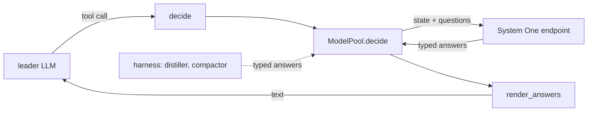

<table>
<tbody>
<tr>
<td></td>
<td><h1 style="color:#234;">SYSTEM ONE</h1></td>
</tr>
</tbody>
</table>

_Decision models as a harness role_

- [README](README.md) — Summary and quickstart
- [DESIGN](DESIGN.md) — Complete overview and reference
- [OPTIONS](OPTIONS.md) — Configuration properties
- [CHANGES](CHANGES.md) — Closed development tasks (with rationale)
- [TODO](TODO.md) — Open development tasks (sorted by impact)

## ▶️ Decide (Shape)

A decision model answers typed questions about a state and returns typed answers with probabilities. It does not generate text, hold a conversation or call tools.

- **Jev** (TypeSafe) — `state` + `questions` in, `choice` / `score` / `noul` out; text only; 32k window; ~70–500 ms; input tokens only.
- **Clef** (Cloudflare) — Jev-API compatible, plus up to 4 embedded images; 64k window; open weights; `@cf/cloudflare/clef` on Workers AI.
- **Question types** — `choice` picks from a map of options, `score` rates against ordered levels, `noul` is the probability a statement is true.
- **Every answer carries probabilities** — `choice` and `score` also carry `confidence`, derived from them.
- **One call, many questions** — questions are evaluated in parallel and in isolation, so adding one barely moves the response time.

> ❗ Not a leader. TypeSafe states it outright: there is no `model: "jev-latest"` that turns a coding agent into a Jev agent. The two solve different problems.

## ▶️ Fit (Existing)

**A role, not a class.** The harness already has the pattern: a specialist model behind a tool, resolved by role, called through the pool.



What already fits:

- `AgentConfig.model_spec(role)` resolves a role to a `ModelSpec`, inheriting the leader's endpoint and credential unless the role declares its own.
- `ROLE_MODEL_FIELDS` maps a role onto a field that is not `<role>_model`, exactly as vision maps to `inference_vlm`.
- `ModelPool` caches one client per endpoint and offers `complete` / `describe_image` beyond the loop, both taking `policy=`, `usage=` and `on_retry=`.
- `ToolRegistry.build` takes optional delegates (`vision=`, `ask=`, `planner=`, `delegate=`, `mapper=`, `folder=`) and appends a tool per delegate.
- `Engine.build_vision` is the template: a `(data_url, question) -> text` delegate, or `None` when unconfigured, which is what decides whether the tool exists.
- `Engine` and `Agent` share `build_tools`, so both get the tool for free.

What does not fit:

- `ModelPool.complete` posts `chat.completions.create` with `messages`; System One wants `{state, questions}`.
- `ModelPool.model` wraps `OpenAIChatCompletionsModel`; a decision model cannot drive the loop.
- `context_window` and `num_ctx` probe `/models` and Ollama `/api/show`; neither applies, and both windows are known constants.
- `stream()` is `Runner.run_streamed` plus `DELTA_KINDS`; there is nothing to stream.

> Key fact: `AGENTIC_INFERENCE_S1M` in `.env` is dead today. `with_env` iterates `fields(self)`, so an undeclared name is silently dropped.

## ▶️ Configure (Role)

**Declare the role, then map its field.** Two lines in the config section, one entry in `ROLE_MODEL_FIELDS`:

```python
DECISION_ROLE = "decision"
ROLE_MODEL_FIELDS = {VISION_ROLE: "inference_vlm", DECISION_ROLE: "inference_s1m"}
```

Fields, following the `<role>_api_url` / `<role>_api_key` convention vision already uses:

```python
# Decision model (System One). With `inference_s1m` set the leader gets the
# `decide` tool: typed questions against a state, typed answers back. The
# endpoint is the whole System One URL, not a `/v1` chat root, because neither
# provider is OpenAI shaped. The credential falls back to the leader's.
inference_s1m: str = ""
decision_api_url: str = ""
decision_api_key: str = ""
decision_enabled: bool = True
# Below this confidence the tool reports the answer as unsure and the leader
# decides for itself. 0 accepts every answer.
decision_confidence: float = 0.0
```

> Key fact: `decision_api_url` is the full URL, which covers both providers with no branching — Jev is `https://api.typesafe.ai/v1/systemone`, Clef is `https://api.cloudflare.com/client/v4/accounts/<id>/ai/run/@cf/cloudflare/clef`.

`banner_items()` gains a row beside the vision one, so the console says which decision model is in play.

## ▶️ Call (Pool)

**One method, beside `describe_image`.** Same `policy=` / `usage=` / `on_retry=` shape, raw `httpx` the way `probe_ollama` already reaches for it:

```python
async def decide(
    self,
    spec: ModelSpec,
    state: str | dict[str, Any],
    questions: dict[str, Any],
    *,
    images: list[str] | None = None,
    policy: RetryPolicy | None = None,
    usage: "Usage | None" = None,
    on_retry: Callable[[dict[str, Any]], Any] | None = None,
) -> dict[str, Any]:
    """One System One call: typed questions against `state`, typed answers back.

    `questions` is the provider's own schema (a map of id to `type` plus
    `instructions` and `criteria`); `images` are data URLs, which only Clef
    accepts. The request is bounded and retried by `policy` and what it spends
    is recorded on `usage`, on the run in progress and on the totals of the
    pool. A failure that survives the policy is raised as a `ModelError`.
    """
    resolved = policy or self.policy
    body: dict[str, Any] = {"model": spec.name, "state": state, "questions": questions}
    if images:
        body["images"] = list(images)

    async def request() -> Any:
        import httpx

        headers = {"Authorization": f"Bearer {spec.api_key}"} if spec.api_key else {}
        async with httpx.AsyncClient(timeout=resolved.timeout or None) as http:
            posted = await http.post(spec.api_url, json=body, headers=headers)
            posted.raise_for_status()
            return posted.json()

    response = await resolved.call(request, role=spec.role, on_retry=on_retry)
    self.record(response.get("usage"), usage)
    return dict(response.get("answers") or {})
```

- `raise_for_status` gives `httpx.HTTPStatusError`, which `error_status` already reads, so the taxonomy classifies it with no new entry.
- `record` takes the provider's `usage` payload, so a decision call is priced and counted like any other.
- `spec.num_ctx` and the window probes are skipped: a decision model has no `num_ctx` and its window is a constant.

## ▶️ Expose (Tool)

**A delegate, then a tool.** `build_decision` mirrors `build_vision`; `ToolRegistry.build` gains one optional argument, and the type aliases gain one entry beside `Asker` and `Delegator`:

```python
#: Answers typed questions about a state: ``(state, questions, images)`` and
#: returns one answer per question, as the provider wrote it.
Decisioner = Callable[[str, dict[str, Any], list[str] | None], Awaitable[dict[str, Any]]]
```

```python
def build_decision(
    self,
    config: AgentConfig,
    *,
    usage: "Usage | None" = None,
    session_id: str | None = None,
) -> Decisioner | None:
    """Return the decision delegate, or ``None`` when no decision model is set."""
    spec = config.model_spec(DECISION_ROLE)
    if spec is None:
        return None
    policy = self.build_policy(config)
    on_retry = self.retry_reporter(session_id)

    async def decide(
        state: str, questions: dict[str, Any], images: list[str] | None = None
    ) -> dict[str, Any]:
        return await self.models.decide(
            spec, state, questions, images=images,
            policy=policy, usage=usage, on_retry=on_retry,
        )

    return decide
```

The tool renders answers to text for the leader, exactly as `describe_image` does:

```python
@function_tool(name_override="decide", description_override=...)
@guard
async def decide(state: str, questions: dict[str, Any]) -> str:
    try:
        answers = await decision(state, questions)
    except asyncio.CancelledError:
        raise
    except Exception as exc:  # the specialist must never break the leader
        return f"Error: the decision model failed: {exc}"
    return render_answers(answers, floor=config.decision_confidence)
```

`render_answers` is the one piece of formatting worth owning, because the leader reads it:

```python
def render_answers(answers: dict[str, Any], *, floor: float = 0.0) -> str:
    """Answers as one line per question, with probabilities and confidence."""
    lines = []
    for name, answer in answers.items():
        kind = str(answer.get("type") or "")
        if kind == "choice":
            line = f"{name}: {answer.get('choice')}"
            line += f" ({_spread(answer.get('probabilities'))})"
        elif kind == "score":
            line = f"{name}: {answer.get('score')}"
            line += f" ({_spread(answer.get('probabilities'))})"
        else:
            line = f"{name}: {answer.get('noul')}"
        confidence = answer.get("confidence")
        if isinstance(confidence, (int, float)):
            line += f" conf {confidence:.2f}"
            if floor and confidence < floor:
                line += " — unsure, decide for yourself"
        lines.append(line)
    return "\n".join(lines) or "(the decision model returned nothing)"


def _spread(probabilities: Any) -> str:
    """A probability map as ``billing 0.97, technical 0.02``, highest first."""
    if not isinstance(probabilities, dict):
        return ""
    ranked = sorted(probabilities.items(), key=lambda pair: -float(pair[1] or 0))
    return ", ".join(f"{name} {float(value):.2f}" for name, value in ranked)
```

> ❗ The tool is text in, text out. That is the right shape for a leader that reads, and the wrong shape for the harness, which wants the numbers.

## ▶️ Consume (Harness)

**Keep the typed answer, not only its rendering.** A decision model returns values with probabilities; rendering to text throws that away.

- `Decision` — a small dataclass (`kind`, `choice`, `score`, `noul`, `probabilities`, `confidence`) parsed from one answer, so a caller branches on numbers.
- `decision.end` — an event carrying the answers, so a client can show the card the way `question.start` shows a question.
- `Engine.decisions` — the answers of the run in progress, keyed by call id, so a finished run can be audited without subscribing.

Then the harness's own judgment calls can use it, which is where the speed and the price pay off:

- `build_distiller` — a full LLM call today to turn a vote into a rule; that is a `choice` over keep / discard plus a `score` of how general the rule is.
- `Compactor` — whether a segment is worth summarising or dropping is a `noul`.
- `Planner` — whether a plan is worth asking about is a `score` against the thresholds already in `AskLimits`.
- `ToolRegistry` — a guardrail before a write or a shell command, at 70–500 ms and input-only pricing, which an LLM is not cheap enough to be.

> Key fact: confidence is the second axis. The answer says what; confidence says whether to act on it. `decision_confidence` is that gate, and it belongs in code rather than in a prompt.

## ▶️ Extend (Class)

**A new class only when the run itself is decisions.** `Engine` is the wrong base for that: `stream()` is `Runner.run_streamed` plus `DELTA_KINDS`, and `turn()` builds an SDK agent.

- `Decider` — a `decide()` method, a `ModelPool`, a `RetryPolicy` and an event bus, and no `stream()`, no tools and no blocks.
- It shares `resolve_config`, `build_model` and `running()`, so it is a sibling of `Engine` rather than a subclass.
- Worth building when a consumer wants a decision service, not an agent. The harness's job is the agentic loop, and a decision model is a collaborator in it.

## ▶️ Phase (Plan)

**Minimum Scope** — the role works end to end behind a tool:

- [ ] `DECISION_ROLE`, the `ROLE_MODEL_FIELDS` entry and the config fields
- [ ] `Decisioner` beside `Asker` and `Delegator`
- [ ] `ModelPool.decide` with `policy` / `usage` / `on_retry`
- [ ] `Engine.build_decision` and the `decide` tool in `ToolRegistry.build`
- [ ] `render_answers`, and the `banner_items` row
- [ ] `OPTIONS.md` entries for the new fields

**Complete Scope** — the harness consumes typed answers:

- [ ] `Decision` dataclass and the parser
- [ ] `decision.end` event and `Engine.decisions`
- [ ] `decision_confidence` gate, reported in the rendered line
- [ ] `build_distiller` on the decision role when one is configured
- [ ] `DESIGN.md` §12 and §21, and the `SYSTEM1.md` link from `README.md`
- [ ] `TODO.md`: the decision model entry points at `SYSTEM1.md`

**Extended Scope** — the harness judges with it:

- [ ] `Compactor` and `Planner` decisions on the decision role
- [ ] A guardrail tool over writes and shell commands
- [ ] Clef images: `view_image` feeding `decide` instead of a vision model
- [ ] `Decider`, for a consumer that wants decisions without a loop

## ▶️ Test (Plan)

**Unit tests, fast, no network.** `test/agentic_bdd.py`, beside the vision and pool cases:

- [ ] `model_spec(DECISION_ROLE)` resolves, inherits the leader's endpoint, and returns `None` when unset
- [ ] `AGENTIC_INFERENCE_S1M` reaches the config through `with_env`
- [ ] `decide` posts the body the provider expects, with and without images
- [ ] A 429 is retried by the policy and a 401 is not
- [ ] `usage` lands on the pool, on the sink and on the run
- [ ] `render_answers` covers all three question types, the confidence floor and an empty answer
- [ ] The tool is absent without a decision model and present with one
- [ ] A failing decision model returns an `Error:` line and never breaks the leader

**Eval, slow, opt-in.** `test/agentic_eval.py`:

- [ ] A scripted decision responder, so the loop is asserted offline and deterministically
- [ ] One live run against Jev and one against Clef, recording latency and cost per call
